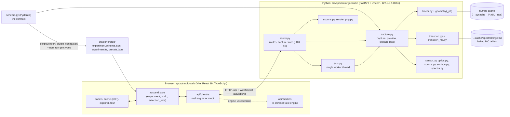
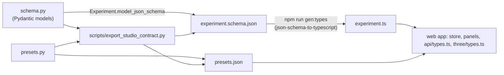

# SpectralForge Studio: architecture

For developers. It describes the pieces, how they talk to each other, where things live, and the rules that keep the browser and the engine consistent. For the physics see [HOW_IT_WORKS.md](HOW_IT_WORKS.md); for recipes and troubleshooting see [DEVELOPER_GUIDE.md](DEVELOPER_GUIDE.md).

## Contents

1. [Component diagram](#1-component-diagram)
2. [HTTP and WebSocket API](#2-http-and-websocket-api)
3. [Jobs, progress, warm-up](#3-jobs-progress-warm-up)
4. [Python module map](#4-python-module-map)
5. [Web app structure](#5-web-app-structure)
6. [Contract-first design](#6-contract-first-design)
7. [Performance and caching](#7-performance-and-caching)
8. [Determinism](#8-determinism)
9. [Tests](#9-tests)

---

## 1. Component diagram

* In **dev** the Vite server (port 5173) proxies `/api` (HTTP and WebSocket) to the engine on 127.0.0.1:8765. In **production** the engine itself serves the built web app from `apps/studio-web/dist` (a SPA fallback route in `server.py`), so one process on one port is the whole product.
* The browser holds the *experiment* (the single source of truth for what is being simulated). The engine is stateless with respect to experiments: every request carries the full experiment JSON. The only engine-side state is the capture store (the last 10 results, in memory), the job table, and the numerical caches.
* If `/api/health` does not answer within 1.2 s the client switches to a **mock engine** that generates synthetic data in the browser and shows an "engine offline — mock data" badge; clicking the badge retries.

## 2. HTTP and WebSocket API

The contract is `apps/studio-web/src/api/types.ts` (TypeScript) implemented by `src/spectraforge/studio/server.py`. Base URL: same origin under `/api`.

| Method and path | Request | Response | Notes |
|---|---|---|---|
| `GET /api/health` | | `{ok, engine_version, schema_version, warmup?}` | `warmup` = `{state, fraction, message, result}`; `state` idle, running, done, error |
| `GET /api/presets` | | `{schema_version, extinction_reference_M_cm, fluorophores, materials, experiments}` | same content as `src/generated/presets.json` |
| `POST /api/validate` | `Experiment` | `{ok, errors[{loc,msg}], warnings[{code,severity,message,target_id?}]}` | Pydantic errors plus cheap static checks plus a 1/8-resolution trace for geometry warnings; never raises on bad input |
| `POST /api/preview` | `{experiment, excitation_nm?, scale?}` | `CaptureMeta` (mode `preview`) | synchronous in a worker thread; result stored like a capture |
| `POST /api/captures` | `{experiment, mode?}` (`sample`, `dark`, `white_reference`) | `{job_id}` | queued on the single capture worker |
| `GET /api/jobs/{id}` | | `JobStatus` | polling fallback |
| `POST /api/jobs/{id}/cancel` | | `JobStatus` | cooperative cancel |
| `WS /api/jobs/{id}` | | stream of `JobEvent` | sends the history first, then live events; closes after `done`, `error` or `cancelled`; close code 4404 for an unknown job |
| `GET /api/captures` | | `CaptureMeta[]` | this server session, newest first |
| `GET /api/captures/{id}` | | `CaptureMeta` | stats per band, saturated fraction, ground-truth layer names, warnings, timings |
| `GET /api/captures/{id}/band?ex=&band=&kind=` | | float32 LE, `H*W` | `kind` is `adu` (default), `radiance` or `electrons` |
| `GET /api/captures/{id}/cube?ex=&kind=` | | float32 LE, `H*W*B`, band fastest | headers `X-Width`, `X-Height`, `X-Bands` |
| `GET /api/captures/{id}/gt/{name}` | | float32 LE, `H*W` | `name` in `CaptureMeta.ground_truth_layers` |
| `GET /api/captures/{id}/image.png?mode=&ex=&band=&gain=&bands=` | | PNG | `true_color` (CIE 1931, auto-exposure at p99), `false_color` (3 bands, p1..p99 stretch), `band` (viridis) |
| `GET /api/captures/{id}/pixel?x=&y=` | | `PixelExplain` | wraps `capture.explain_pixel`; coordinates in the capture's own resolution |
| `GET /api/captures/{id}/download?format=` | | file attachment | `spectradata_pkl`, `npz`, `tiff_zip`, `ground_truth_zip`, `experiment_json` |
| `POST /api/captures/{id}/eem` | `{roi, norm?, stat?}` | `EemResult` | v1.1. EEM of a pixel / disk / rect / ellipse / polygon ROI; `norm.mode` in `adu`, `radiance`, `electrons`, `dark_subtracted`, `exposure_power`, `white_normalized`, `irradiance_normalized` (needs the capture's `irradiance@<ex>` map; 422 with a message otherwise) |
| `POST /api/captures/{id}/roi` | `{roi, norm?, stat?, components?}` | `RoiStats` | band statistics plus ground-truth statistics (and averaged components) of a ROI |
| `POST /api/captures/{id}/line` | `{p0, p1, width_px?, norm?, excitations_nm?, ground_truth?}` | `LineProfile` | bands along a line, ground-truth traces |
| `POST /api/captures/{id}/response` | `{x_ground_truth, metric, roi?, bins?, norm?}` | `ResponseCurve` | metric versus a ground-truth map |
| `GET /api/captures/{id}/volumes`, `GET /api/captures/{id}/volume?object=&kind=&ex=&channel=` | | `VolumeInfo[]`, float32 `(nx, nz, layers*sublayers)` | 3D light field of a layered block (`fluence`, `absorbed`, `source`) |
| `POST /api/sweeps`, `GET`/`POST cancel /api/sweeps/{id}`, `WS /api/sweeps/{id}` | `{experiment, parameter{path, values, label}, mode}` | `{sweep_id}`, `SweepStatus`, stream of `SweepEvent` | v1.1. Runs one capture or preview per value of any numeric experiment parameter |

Error conventions: 422 with a Pydantic issue list for an invalid experiment or parameter, 404 for an unknown capture, job, band or pixel (the capture store keeps only the most recent ones), 500 with `ExceptionType: message` when the engine fails. CORS and the CSRF origin guard allow the app's own origin (the engine serving `dist/`) and exactly `http://localhost:5173` / `http://127.0.0.1:5173` (the Vite dev server); any other `Origin` (for example Vite falling back to port 5174) is refused with 403.

## 3. Jobs, progress, warm-up

**Jobs** (`jobs.py`). `JobManager` owns one daemon worker thread and a queue; captures are CPU-heavy (the engine already uses all cores through numba and BLAS), so they run **one at a time**, the rest wait in the queue (`queued` → `running` → `done` | `error` | `cancelled`). A `Job` records an event list (`progress` events are monotonic in fraction and de-duplicated; one terminal event), so a WebSocket client that connects late replays the history. `cancel` sets a flag that `capture()` polls between pixel chunks; a cancelled capture raises `Cancelled` and stores nothing. The manager keeps the last 50 jobs.

**Progress messages** come from `capture.capture(progress=...)` and have a stable format that the UI parses (`state/progress.ts`): `tracing rays`, `simulating <ex> nm (i/n) · radiance`, `sensor <ex> nm (i/n)`, `done` (the separator is U+00B7 with one space on each side). The fraction budget is 0–0.08 tracing and setup, 0.08–0.70 radiance, 0.70–0.99 sensor, then `storing`. The web client uses it for the progress bar, the ETA, the per-line chip highlight and the beam colour in the 3D view. Do not change the format without changing `state/progress.ts` and its test.

**WebSocket vs polling.** `api/client.ts` opens `ws(s)://<host>/api/jobs/{id}`; on error or an unexpected close it falls back to polling `GET /api/jobs/{id}` every 500 ms.

**Warm-up** (`transport.start_warmup`, started from the FastAPI lifespan in `server.main()` as a daemon thread; `create_app()` itself does not start it, so tests never trigger bakes). It (1) loads or compiles every numba kernel with tiny inputs and traces the `laser_line` preset once, (2) bakes or loads from disk the white-Monte-Carlo tables for every `(g, n, n_outside)` combination used by the four builtin presets (7 combinations at the default settings), (3) assembles the per-(material, excitation) kernel tables of those presets. `/api/health` reports its progress, and previews or captures issued meanwhile simply work (more slowly) because they share the same in-process transport model. Measured on an Apple-silicon laptop: ~60 s with an empty cache (≈52 s of it table bakes), ~4 s with a warm cache.

## 4. Python module map

All under `src/spectraforge/studio/`. Line counts are approximate.

| Module | Role | Key public names |
|---|---|---|
| `schema.py` | **The contract**: the Pydantic `Experiment` model (extra fields forbidden, validated references) | `Experiment`, `FluorophoreSpec`, `MaterialSpec`, `SceneObject`, shapes (`BoxShape`, `SphereShape`, `CylinderShape`, `DropletShape`, `PetriDishShape`, `CuvetteShape`), `LightSourceSpec`, `CameraSpec`, `PhysicsToggles`, `AcquisitionSettings`, `SCHEMA_VERSION`, `EXTINCTION_REFERENCE_M_CM` |
| `presets.py` | builtin fluorophores (the 2-D library plus `optical_brightener`, `chlorophyll_a`), materials, 7 experiment presets (incl. `layered_wedge_phantom`, `tissue_under_collagen`, `pencil_beam_penetration`) | `builtin_fluorophores`, `builtin_materials`, `PRESETS`, `preset(name)`, `nuance_camera`, `tunable_lamp` |
| `contracts.py` | engine-internal data contracts and the radiometric definitions | `HitBuffer`, `MaterialOptics`, `TransportKernels`, `TransportModel`, `CaptureResult`, `SPECTRAL_GRID_NM`, `MAX_LAYERS` |
| `geometry.py` | analytic solids as CSG of convex primitives, exact vectorised intersections | `build_scene`, `Scene.first_hit`, `Scene.locate`, `euler_xyz_matrix`, `BACKGROUND_OBJECT` |
| `geometry_nb.py` | numba ports of the intersection kernels and the fused volume-shadow kernel | `first_hit_nb`, `locate_nb`, `volume_shadow_nb`, `compile_solids` |
| `surface.py` | Fresnel (unpolarised, TIR), Snell refraction, GGX microfacet BRDF | `fresnel_reflectance`, `fresnel_transmittance`, `refract`, `ggx_brdf` |
| `source.py` | beam profile and irradiance, line shape, Xe curve, filter leakage, power drift | `beam_samples`, `irradiance_per_mW`, `line_shape`, `leakage_spectrum`, `drifted_powers` |
| `tracer.py` | camera rays, layered ray tracing, shadow rays, volume samples | `trace_scene`, `camera_basis`, `camera_rays`, `image_distance_mm` |
| `optics.py` | `MaterialSpec` to `MaterialOptics` (μa from ε, scattering, quenching, emission density) | `material_optics`, `merged_fluorophores`, `dye_extinction_M_cm`, `average_over_line` |
| `spectra.py` | tabulated spectra: water, haemoglobin, melanin, carbon black, QE curves, LCTF peak transmission, room lights, CIE V(λ) | `absorber_mua_per_mm`, `qe`, `filter_peak_transmission`, `room_light_irradiance_mW_mm2_nm` |
| `transport.py` | closed-form clear kernel, baked white-MC tables, per-material J tables, radial profile, warm-up | `clear_medium_kernel`, `get_transport_model`, `MCTransportModel.kernels`, `bake_tables`, `warmup`, `start_warmup`, `warmup_status` |
| `transport_mc.py` | numba Monte Carlo (white MC bake, MCML reference for tests, turbid pixel kernel, clear kernel) | `bake_arrays`, `mcml_slab`, `turbid_pixels`, `clear_G` |
| `sensor.py` | bands, angle shift, étendue, blur, detector | `band_centres`, `band_responses`, `project_bands`, `blur_sigma_px`, `blur_cube`, `detect`, `CameraOptics` |
| `capture.py` | orchestration: components, FRET, secondary emission, Raman, bleaching, subsurface spread, white-reference geometry, ground truth | `capture`, `preview`, `explain_pixel`, `white_reference_experiment`, `GROUND_TRUTH_KEYS` |
| `transport3d.py`, `transport3d_mc.py` | v1.1 3D Monte Carlo of layered blocks (MCML on tilted planes, peel-off estimator, fluence/absorbed tallies, emission pass) and its numba kernels | `excitation_pass`, `emission_pass`, `planes_from_layers` |
| `block_capture.py` | builds the 3D MC inputs from the experiment (launch, region optics, sources per channel, adaptive emission nodes), turns tallies into pixel radiance, caches results | `PEEL_PHOTON_FACTOR`, `SMOOTH_SIGMA_MM`, `choose_emission_nodes` |
| `analysis.py` | v1.1 scientist-facing analysis (normalisation modes, ROI, EEM, line profile, response curve, volumes, `load_npz_capture`) as pure functions on a `CaptureResult` | `normalize`, `eem`, `roi_stats`, `line_profile`, `response_curve`, `volume`, `load_npz_capture` |
| `sweeps.py` | v1.1 parameter sweeps: sets a value by JSON pointer, runs a capture per value | `SweepManager` |
| `server.py` | FastAPI app factory, validation warnings, capture store, SPA serving, CLI `main()` | `create_app`, `main`, `static_warnings`, `trace_warnings`, `CaptureStore` |
| `jobs.py` | single-worker job manager | `JobManager`, `Job`, `Cancelled` |
| `exports.py` | `SpectraData` pickle, npz, TIFF zip, ground-truth zip, experiment JSON | `build_export`, `spectradata_payload`, `FORMATS` |
| `render_png.py` | server-side colour rendering (CIE true colour, false colour, viridis band) | `true_color`, `false_color`, `band_image`, `encode_png` |
| `__main__.py` | `python -m spectraforge.studio` entry point | calls `server.main()` |

Scripts: `scripts/export_studio_contract.py` (contract export) and `scripts/studio_validation_figures.py` (regenerates every figure and number of [PHYSICS_VALIDATION.md](PHYSICS_VALIDATION.md); `--quick` takes ~1 min).

**Dependency direction** (no cycles): `schema` ← `presets`, `optics`, `source`, `tracer`, `capture`; `contracts` ← `tracer`, `transport`, `optics`, `capture`; `capture` imports `tracer` and `transport` lazily so that tests can inject fakes (`capture(..., tracer=, transport=)`); `server` imports the real `capture` lazily for the same reason.

## 5. Web app structure

`apps/studio-web/` (Vite 6, React 19, TypeScript 5.8, three r186, @react-three/fiber 9, drei 10, @react-three/postprocessing, zustand 5 + immer, vitest, Playwright).

| Path | Contents |
|---|---|
| `src/state/` | `store.ts` (zustand: experiment, undo/redo with coalescing, selection, mode, ui flags, captures, job, warnings), `actions.ts` (`initEngine`, debounced `startValidation`, `runPreview`, `runCapture`, `cancelJob`), `hotkeys.ts`, `io.ts` (`.sfx.json` open/save, autosave to `localStorage`), `library.ts` (lab-ware factories), `presets.ts` (the bundled `presets.json`), `progress.ts` (parses the engine's progress messages) |
| `src/api/` | `types.ts` (the HTTP contract), `client.ts` (`realEngine`, `detectEngine`, WebSocket with polling fallback), `mock.ts` + `mockScene.ts` (in-browser fake engine: synthetic cubes and explanations) |
| `src/scene/` | the 3D viewport assembly: `Viewport.tsx` (R3F canvas, toolbar, drag-and-drop from the library), `SceneRoot.tsx`, `Nodes.tsx`, `Gizmos.tsx` (transform gizmo, drag-to-aim handle, readouts, camera-fly `ViewBridge`), `Pip.tsx` (picture-in-picture camera view), `RenderLoop.tsx`, `viewApi.ts` |
| `src/panels/` | `TopBar.tsx`, `Outliner.tsx`, `Library.tsx`, `Inspector.tsx` with `inspector/*` (object, material, source, camera, scene and acquisition inspectors), `AcquireBar.tsx` (sequence bar, preview, capture, dark, white ref) |
| `src/explorer/` | `Explorer.tsx` (captures list, band scrubber, colour modes, GT overlay, compare, export), `ImageView.tsx` (canvas), `PixelPanel.tsx` (component decomposition, EEM, ROI), `data.ts` (cube/pixel/GT hooks), `render.ts` |
| `src/three/` | presentational 3D models, driven only by props (no store access): hardware (`TunableLampModel`, `LedArrayModel`, `LaserModel`, `CameraModel`, `CameraFrustum`, `BeamVolume`), `SampleMesh.tsx`, `Stage.tsx`, `StudioEnvironment.tsx`, `pose.ts`, `types.ts`; `showcase.html` renders them standalone |
| `src/analysis/` | v1.1 analysis workspace: ROI tools and store (`store.ts`, `roi.ts`), tabs (`EemPanel`, `LinePanel`, `ResponsePanel`), `NormBar` + `norm.ts` (normalisation modes), `layeredDefaults.ts` (layered-block defaults), `LightField.tsx`, CSV/JSON export; own zustand stores, independent of the experiment store |
| `src/sweep/` | v1.1 sweep store, parameter enumeration (`paths.ts`), `SweepPanel.tsx` |
| `src/tour/` | the guided tour: `steps.ts` (script), `Tour.tsx` (card and controller), `tourStore.ts` |
| `src/lib/` | client-side spectral maths, camera intrinsics, beam colour, formatting, lighting |
| `src/ui/` | controls, SVG/canvas charts, colormaps, icons, toast |
| `src/generated/` | **generated, do not edit**: `experiment.schema.json`, `experiment.ts`, `presets.json` |
| `scripts/` | Playwright scripts: `screenshots.mjs`, `tour-shots.mjs`, `shoot-three.mjs`, `smoke.mjs`, `check-framing.mjs` |

**State rules.** The experiment lives only in the store; every edit is an immer recipe through `edit(recipe, coalesceKey)` (one undo step per key within 700 ms). Anything that changes the experiment triggers a debounced (380 ms) `POST /api/validate`. The 3D view is "what you see is what you capture": the viewport camera, the PiP and the engine use the same pinhole model (`lib/camera.ts`, `three/pose.ts`, `tracer.camera_basis`).

## 6. Contract-first design

The experiment schema is defined **once**, in Python, and everything else is generated from it:

* `schema.py`'s `SCHEMA_VERSION` (`"1.0"`) is carried in every experiment and reported by `/api/health` and `/api/presets`.
* `scripts/export_studio_contract.py` writes `experiment.schema.json` and `presets.json` into `apps/studio-web/src/generated/` (it converts `prefixItems` tuples to draft-7 `items` arrays for the type generator); `npm run gen:types` then writes `experiment.ts`. Run both after editing `schema.py` or `presets.py`; regenerating on an unchanged tree reproduces the committed files exactly (verified).
* `api/types.ts` (HTTP shapes) and `three/types.ts` (prop contracts of the 3D components) are small **hand-written** contracts layered on `experiment.ts`.
* Engine-internal data (`HitBuffer`, `TransportKernels`, `CaptureResult`) are contracts between Python modules only (`contracts.py`); they never cross the wire.
* Rule of thumb: **change `schema.py` first, regenerate, then fix whatever the TypeScript compiler complains about**. The Pydantic model forbids extra fields, so a stale browser against a newer engine fails loudly at `/api/validate` instead of silently ignoring a setting.

## 7. Performance and caching

* **numba JIT cache.** All kernels are `@njit(cache=True)`; compiled code is stored next to the sources (`__pycache__/*.nbi`, `*.nbc`). The first run in a fresh checkout compiles for ~20 s; later processes load in ~1 s. `NUMBA_CACHE_DIR` relocates the cache.
* **Monte Carlo table cache.** Baked white-MC tables are `tables_<hash>.npz` files in `~/.cache/spectralforge/mc` (override with the environment variable `SPECTRALFORGE_MC_CACHE`). The hash covers the engine version, `(g, n, n_out)`, the photon count, the seed and the grid definitions, so changing `acquisition.mc_photons` or `seed` bakes new tables; a corrupt file is deleted and rebaked; a read-only directory falls back to memory only. With the builtin presets the cache is ~270 MB. A bake of one `(g, n, n_out)` takes several seconds at the default 200 000 photons; the 7 combinations of the builtin presets took ~52 s from an empty cache.
* **In-process caches.** `get_transport_model()` hands out one shared, thread-safe model per `(n_photons, seed, cache_dir)`; it keeps LRU caches of baked tables (16), per-(material, excitation) `J` tables (128, ~1.7 MB each) and radial profiles (512). Preview, capture and `explain_pixel` therefore reuse each other's work.
* **Parallelism.** The geometry, volume-shadow, Monte Carlo and turbid-pixel kernels are `prange`-parallel; results do not depend on the thread count. Captures are serialised by the job worker so that they do not fight for cores.
* **Measured** (Apple-silicon laptop, warm caches): `laser_line` trace at 348×256 ≈ 0.44 s; ME-HSI lab-replica full capture (348×256, 8 excitations × 31 bands) ≈ 15 s (trace 0.15 s, radiance 12 s, sensor 2.5 s); a preview at a quarter resolution ≈ 0.4 s (as shown in the UI toast). Targets from the design: preview < 300 ms after bakes are cached, full capture < 30 s.
* **Memory.** A lab-replica `adu` cube is 8 × 256 × 348 × 31 × 4 B ≈ 88 MB; the capture store keeps `adu`, `radiance` and `electrons_mean` per capture, so the last-10 LRU bound matters at higher resolutions.

## 8. Determinism

A given `(experiment, seed)` produces a bit-identical capture: every random draw (power drift, detector noise, fixed pattern, Monte Carlo bake) has its own `SeedSequence`-derived stream, and the parallel kernels are thread-count independent. See [HOW_IT_WORKS §12](HOW_IT_WORKS.md#12-determinism). Practical consequences: tests can compare to stored numbers, "Dark" and "Sample" captures differ only by their mode-specific stream, and two exports of the same capture are byte-identical.

## 9. Tests

| Suite | Where | What it covers |
|---|---|---|
| Python | `tests/studio/` (slow tests are marked `slow`; the v1.1 suites add transport3d, block capture, analysis, sweeps and server-analysis tests) | geometry, surface, source, optics, spectra, tracer, transport (MCML, diffusion, reciprocity, cache), sensor, capture (energy, dilute limit, bleaching, determinism), server (with fake engines), exports, QA regressions |
| Web unit | `apps/studio-web/src/**/*.test.ts` (vitest, including the analysis workspace and the mock engine's v1.1 endpoints) | store (undo, coalescing), spectral maths, progress parsing, mock engine, explorer rendering |
| UI | `apps/studio-web/scripts/smoke.mjs`, `check-framing.mjs` | Playwright smoke test of the main flow; engine image vs 3D projection (about one pixel) |
| Validation | `scripts/studio_validation_figures.py` | regenerates the figures and numbers in PHYSICS_VALIDATION.md |

The server tests inject fake `capture`/`preview`/`explain` callables into `create_app(...)`; this is the intended way to test anything that touches the API without paying for a simulation.
