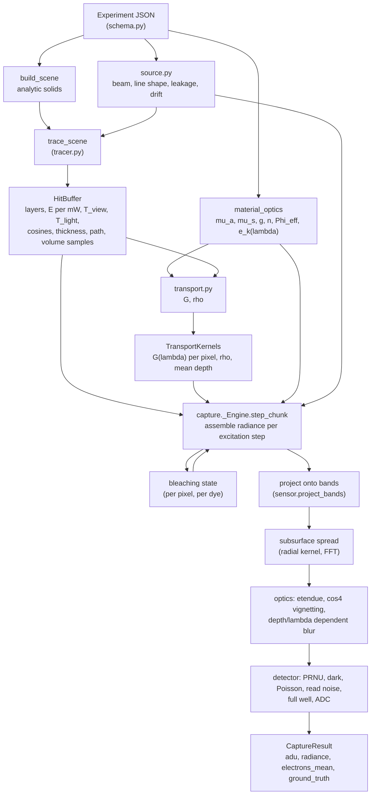

# How the SpectralForge Studio simulation works

This document explains, end to end, what the engine computes when you press **Preview** or **Capture**: from the experiment JSON to the noisy 16-bit cube and the ground-truth layers. It is written for a scientist who knows fluorescence spectroscopy and imaging; no knowledge of the code is needed, but every statement was checked against `src/spectraforge/studio/` (module and function names are given so you can follow along). Evidence that the model behaves as claimed is in [PHYSICS_VALIDATION.md](PHYSICS_VALIDATION.md); the limits are summarised at the end and in more detail there.

Related documents: [README](README.md) (index) · [USER_GUIDE](USER_GUIDE.md) · [ARCHITECTURE](ARCHITECTURE.md) · [DEVELOPER_GUIDE](DEVELOPER_GUIDE.md).

## Contents

1. [Units and conventions](#1-units-and-conventions)
2. [The pipeline at a glance](#2-the-pipeline-at-a-glance)
3. [The experiment: what goes in](#3-the-experiment-what-goes-in)
4. [The light source](#4-the-light-source)
5. [The tracer: from camera rays to a HitBuffer](#5-the-tracer-from-camera-rays-to-a-hitbuffer)
6. [Material optics](#6-material-optics)
7. [Transport: the kernel G](#7-transport-the-kernel-g)
8. [Assembling the radiance](#8-assembling-the-radiance)
9. [Photobleaching over the sequence](#9-photobleaching-over-the-sequence)
10. [The sensor](#10-the-sensor)
11. [Outputs and acquisition modes](#11-outputs-and-acquisition-modes)
12. [Determinism](#12-determinism)
13. [Approximations and limits](#13-approximations-and-limits)

---

## 1. Units and conventions

| Quantity | Unit |
|---|---|
| length | mm |
| wavelength | nm |
| angle (schema) | degrees (radians internally) |
| power | mW |
| exposure | ms |
| concentration | µM |
| absorption / scattering coefficient | 1/mm |
| irradiance `E` | mW/mm² |
| radiance `L` | mW mm⁻² sr⁻¹ nm⁻¹ (spectral) or mW mm⁻² sr⁻¹ (band-integrated) |
| transport kernel `G` | mm/sr |

* **World frame**: right-handed, **Y up** (the three.js convention). The optical table top is `y = 0`; the background slab occupies `y ∈ [−thickness, 0]`.
* **Rotations**: object `rotation_deg` is an intrinsic Euler XYZ rotation (`R = Rx(a) Ry(b) Rz(c)`, identical to three.js `Euler(a, b, c, 'XYZ')`). Sources and cameras are posed by `position_mm` + `target_mm` (look-at) + `roll_deg`; the optical axis is the device's local −Z. Both the browser (`three/pose.ts`) and the engine (`tracer.camera_basis`) build the same orientation, which is why the 3D view and the engine image agree (checked to about one pixel by `apps/studio-web/scripts/check-framing.mjs`).
* **Image orientation**: array `(H, W, B)`; row 0 is the image **top**, column 0 the image **left**. A camera above the table looking straight down has world +X on the image right and world −Z at the top.
* **Spectral grid**: every module works on one fine grid, `contracts.SPECTRAL_GRID_NM = 250…900 nm in 1 nm steps` (651 samples). Band signals are plain sums over it.
* **Molar extinction**: `ε(λ) = extinction × 55 000 M⁻¹cm⁻¹ × excitation_profile(λ)`; the profile is a peak-normalised Gaussian. `extinction = 1` means the EGFP-like reference value 55 000 (`schema.EXTINCTION_REFERENCE_M_CM`).

## 2. The pipeline at a glance



`capture.capture()` is the orchestrator. It does, in this order:

1. `trace_scene()` once for the whole capture (the geometry does not depend on the excitation).
2. Builds a `_Engine`: `material_optics()` for every material on the fine grid.
3. `_prepare_steps()`: for each enabled excitation step the band centres, the band response matrices (one per field-angle ring), the line shape and leakage spectrum, the delivered (drifted) power.
4. `_run_engine()`: **step-outer, chunk-inner** loop. For every excitation step, in sequence order, every pixel chunk (4096 pixels) gets its spectral radiance assembled (section 8) and projected onto the bands. Bleaching state is pixel-local, so this loop order is equivalent to following each pixel through the whole sequence.
5. Sensor stage per step: subsurface spread, electron conversion, blur, detector (section 10).
6. Ground-truth maps and warnings.

Progress is reported as `tracing rays` (0–8 %), `simulating <ex> nm (i/n) · radiance` (8–70 %), `sensor <ex> nm (i/n)` (70–99 %), `done`.

**Preview** is the same code with one excitation step and a reduced resolution (`preview_scale`, default 0.25). **explain_pixel** reruns the engine for one pixel with every component kept separate.

## 3. The experiment: what goes in

An `Experiment` (`schema.py`, Pydantic) holds fluorophores (added to or overriding the builtin library), materials, objects, a background, light sources with their excitation sequences, cameras, and the acquisition settings including the 26 physics toggles. It is embedded verbatim in every export (`CaptureResult.experiment_json`), so a cube can always be traced back to the exact configuration that made it.

* **Every material is a uniform optical medium** (a volume), even "surfaces": white paper is a strongly scattering volume with an optical-brightener dye; black anodised aluminium is a strongly absorbing, rough, weakly scattering volume. A material is defined by: dye list (fluorophore, µM), refractive index `n`, scattering (`mus'(500)`, power `b`, anisotropy `g`), a background absorber (water, haemoglobin, melanin, carbon black, custom table), GGX surface roughness, an `aqueous` flag (switches on the water Raman line), a Stern-Volmer constant, FRET pairs.
* **Objects** are analytic solids (`geometry.py`): box, sphere, Y-axis cylinder, sessile droplet (sphere ∩ half-space), petri dish and cuvette (a vessel = CSG difference outer shell minus open cavity, plus a fill solid of the object's material up to `fill_height_mm`; the vessel material defaults to `glass`). Intersections are exact and vectorised (numba kernels in `geometry_nb.py`, parity-tested against the NumPy reference to 1e-10).
* **The background** is a box slab of one material under the table; it is the last solid, so objects win ties.

## 4. The light source

`source.py` models the excitation in two independent parts: where the light goes (geometry) and which wavelengths it contains (spectrum).

**Beam geometry.** The source at `position_mm` emits along `a = (target − position)/|…|`. The beam radius grows linearly with the axial distance `z` from the exit aperture:

```
w(z) = D/2 + z · tan α            D = aperture_diameter_mm, α = divergence half-angle
```

The rays appear to come from a virtual apex at `z0 = −(D/2)/tan α` behind the aperture, so the on-axis irradiance eventually falls as inverse square. Irradiance per 1 mW of source power on the plane perpendicular to the axis:

```
Gaussian:  I(r, z) = 2 / (π w²) · exp(−2 r² / w²)                        (∫ I dA = 1)
Flat-top:  I(r, z) = ½ erfc((r − w)/(√2 σ)) / (π (w² + σ²)),  σ = 0.03 w  (soft edge, ∫ I dA = 1)
```

The flux density along the local propagation direction ŝ (apex → point) is `S = I / cos φ`, `cos φ = ŝ·a`. A surface with outward normal `n` receives `E = S · max(0, −ŝ·n)` (mW/mm² per mW, before any Fresnel loss). Points behind the aperture (`z ≤ 0`) get zero. All of this is `source.beam_samples()` / `source.irradiance_per_mW()`.

**Spectral line.** `source.line_shape()` returns an area-normalised line (units 1/nm) integrated analytically per 1 nm bin (differences of the Gaussian CDF, so even a 1 nm laser line is exact): Gaussian of FWHM `line_fwhm_nm` for lamp and laser; a split-normal for the LED with a red half-width 1.4 times the blue one at the same total FWHM (LED emission has a red tail). The in-band power of a step is exactly its `power_mW`; the Xe curve does **not** change the in-band power.

**Out-of-band leakage.** A clean-up filter of optical density OD lets through `10^−OD` of the source's out-of-band emission, per mW of in-band power (`source.leakage_spectrum`):

* tunable lamp: the xenon continuum, `10^−OD · X(λ) / (X(λ0) · 1.0645 · FWHM)`, with a notch at the selected line (`X` is a tabulated Xe-arc curve plus Xe I/II lines; `lamp_curve = "flat"` replaces it by a constant);
* LED: a broad Lorentzian tail; laser: a 10⁻³ fraction of that (essentially nothing).

This is why a UV line behind a visible-passing emission filter can still show a faint leakage image: the xenon visible output is far stronger than the UV line power.

**Power drift.** The delivered power of step *i* is `P_i (1 + σ ξ_i)`, `ξ ~ N(0,1)`, `σ = power_drift_pct/100`, clipped at zero, drawn from a generator seeded by `(seed, mode)` so it is deterministic.

## 5. The tracer: from camera rays to a HitBuffer

`tracer.trace_scene(experiment, width, height)` converts the geometry into a `contracts.HitBuffer`: all per-pixel optical-geometry quantities the radiometry needs, independent of wavelength. (The module docstring of `tracer.py` is the detailed reference.)

**Camera model.** A pinhole at the lens position with the thin-lens image distance `v = f s / (s − f)` (`s = focus_distance_mm`). The sensor measures `width_px · pitch · binning` by `height_px · pitch · binning`; a scaled-down request (preview) is a coarser grid over the same sensor area. The ray of pixel (col, row) is `(x_s X + y_s Y − v Z)` normalised, with `x_s = (col + ½ − W/2) p_x`, `y_s = (H/2 − row − ½) p_y`. The per-pixel `field_angle_rad` (angle of the chief ray to the optical axis) is stored for vignetting and filter angle shift.

**Layers (clear-media chains).** A camera ray may pass through several media before it hits something opaque (a petri dish: glass → medium → glass; a cuvette: glass → liquid → glass). The HitBuffer therefore stores up to `MAX_LAYERS = 4` **layers** per pixel:

* layer 0 is the first surface the ray enters;
* if that medium is **clear** (no scattering, or the scattering toggle is off) the ray refracts in (Snell, unpolarised Fresnel), travels the exact chord, refracts out into whatever lies beyond (air or an adjacent solid) and continues as layer 1, and so on;
* a **turbid** medium or the background slab ends the chain (the transport kernel treats it as a semi-infinite or finite slab);
* a total-internal-reflection event at an exit terminates the chain (the reflected branch is not followed).

Each layer carries: material index, object index, entry point and outward normal, the chord `path_mm` inside the medium, external and internal view/light cosines, the medium thickness along the normal, the cumulative Fresnel transmittances `T_view` (camera side) and `T_light` (source side) of interfaces crossed *before* this layer's entry interface (the entry interface itself is applied inside the kernel `G`), the refractive index outside the entry interface, the irradiance per mW, and `light_clear_path_mm` (the shadow-ray path length through each clear material, for Beer-Lambert).

**Shadow rays.** From every layer entry point a straight shadow ray runs toward the source's aperture. It collects the Fresnel transmittance of each clear interface it crosses (Snell applied successively from the source side), the chord through each clear material (for Beer-Lambert absorption of the excitation by, e.g., glass or liquid in front), and sets `T_light = 0` if a non-clear object blocks the line (a shadow). The line is straight; the lateral shift through thin glass is ignored. A shadow ray may cross at most 16 interfaces.

**Volumetric samples (side-lit clear media).** The slab picture (light enters through the same face the camera looks through) fails for, e.g., a laser crossing a cuvette sideways while the camera looks at 90°. For every clear layer the tracer therefore also places `Q = 16` Gauss-Legendre nodes along the exact refracted view chord and, for each node, traces the excitation back to the source through its **own** light-entry face. It stores the node distance `vol_s_mm`, quadrature weight, the excitation fluence per mW at the node (beam intensity × Fresnel transmittance of every crossing × refraction beam-compression factor), the excitation path inside this medium, and the Fresnel `T_out` of the view-entry face. `capture` turns these into an equivalent kernel `G` (section 7.2).

**Specular glint.** At the first interface a GGX microfacet BRDF (Smith shadowing, unpolarised Fresnel) gives `glint_per_mW`, the radiance factor with which the source mirror image reaches the camera; roughness is the material's `surface_roughness`.

**Ground-truth geometry** (material and object id, depth, cosines, path, thickness, shadow flag) comes for free from the first layer.

## 6. Material optics

`optics.material_optics(material, fluorophores, grid, toggles)` produces a `MaterialOptics`: everything the transport and assembly stages need, as arrays on the fine grid.

**Dye absorption.** For dye *k* at concentration `c_k`:

```
ε_k(λ)   = extinction_k · 55 000 · exc_k(λ)                  [M⁻¹ cm⁻¹]
μa,k(λ)  = ln(10) · ε_k(λ) · c_k[M] / 10                      [1/mm]
```

(the `/10` converts 1/cm to 1/mm). Example: fluorescein, ε_max = 76 900, 10 µM → μa = ln10 · 76 900 · 10⁻⁵ / 10 = 0.177 /mm, a 1/e depth of 5.6 mm; at 200 µM the 1/e depth is 0.28 mm. The total absorption is `μa = Σ_k μa,k + μa,background`, where the background absorber (`spectra.py`) is tabulated water (Pope & Fry, Segelstein), haemoglobin (Prahl), melanin (~λ^−3.46, Jacques), carbon black or a custom `(nm, 1/mm)` table.

**Scattering.** Reduced scattering is a power law, and the scattering coefficient follows from the Henyey-Greenstein anisotropy:

```
μs'(λ) = μs'(500) · (λ / 500 nm)^(−b)         μs = μs' / (1 − g)
```

A material with `scattering.model = "none"` or `μs'(500) = 0` is **clear**.

**Quenching.** Collisional (Stern-Volmer) self-quenching with the total dye concentration of the material:

```
Φ_eff,k = Φ_k / (1 + K_sv · Σ_j c_j[µM])
```

**Emission density.** `e_k(λ)` is the emission shape of the legacy 2-D library (Gaussian with optional skew and vibronic shoulder), divided by the grid step so that `∫ e_k dλ = 1` (1/nm). This ties the 3-D engine to the validated 2-D engine (dilute-limit agreement in validation figure 4).

**Toggles.** `absorption = off` removes the *inner filter*: the attenuation used by the transport model drops to a negligible floor (1e-9 /mm) while the dyes still absorb enough to fluoresce, so signal becomes linear in concentration at any concentration. `scattering = off` makes every material clear. `quenching = off` sets `Φ_eff = Φ`.

## 7. Transport: the kernel G

All geometry and medium effects between "excitation irradiance on the surface" and "radiance leaving toward the camera" are folded into one factor, the **transport kernel** `G(λem)` in mm/sr. The radiometric definition, used by every module (`contracts.py`):

```
L(λem) = E · Σ_k ⟨μa,k⟩_line · Φ_k · e_k(λem) · G(λem)          [mW mm⁻² sr⁻¹ nm⁻¹]
```

`E` is the excitation irradiance on the surface (mW/mm², includes the incidence cosine, **before** Fresnel transmission); `⟨μa,k⟩_line` is the dye absorption averaged over the excitation line shape. `G` contains *everything else*: Fresnel in and out, refraction, the `1/n²` basic-radiance (étendue) factor, the `1/4π` of isotropic emission, depth integration, attenuation of the excitation on its way in, and re-absorption of the emission on its way out. Inner-filter and reabsorption effects are therefore **not knobs**: they emerge from `G` when `μa` is large.

### 7.1 Clear media: closed form

For a non-scattering slab (`transport.clear_medium_kernel`, numba kernel `transport_mc.clear_G`):

```
G = T_in · T_out / (4π · n² · cos θi′) · (1 − exp(−κ L)) / κ
κ = μt,ex · cos θo′ / cos θi′ + μt,em
```

`θi′`, `θo′` are the refracted internal angles of the excitation and the view ray (Snell with `n_outside → n`), `L` is the view chord inside the object (exact, from the tracer), `μt = μa + μs`, `T_in` is the Fresnel transmittance of the entry interface at the excitation angle, `T_out` that of the exit at the view angle (0 on TIR). The expression `(1 − e^{−x})/x` is evaluated with `expm1`. Limits: `κL → 0` gives `G → T_in T_out L / (4π n² cos θi′)` (dilute, optically thin); `κL → ∞` gives the front-face plateau `1/κ`.

### 7.2 Clear media lit through another face: volume quadrature

For a laser through a cuvette the light-entry face differs from the view-entry face and the closed form does not apply. `capture._Engine._volumetric_G` uses the tracer's volume samples:

```
G = T_out / (4π n²) · ∫ F(s) · exp(−μt,ex · l(s)) · exp(−μt(λem) · s) ds
```

along the view chord, where `F(s)` is the excitation fluence per mW at the sample, `l(s)` the excitation path inside the medium and `s` the emission path to the view-entry face. A plain point rule fails when the exponentials decay faster than the node spacing (up to −70 % error at 1 mM fluorescein), so each node's cell `[a_q, b_q]` is integrated **exactly** with `F` constant and `l(s)` linear: with `E(s) = −μt,ex·l(s) − μt(λ)·s`, the cell integral is `F_q (e^{E_a} − e^{E_b}) / (−dE/ds)`. This reduces to the point rule when optically thin and gives the correct `1/κ` surface layer when thick. For cuvettes in a row, the Beer-Lambert attenuation of the beam by the clear media crossed before the cuvette is applied by a ray march in `_prior_occluder_paths`.

### 7.3 Turbid media: white Monte Carlo with reciprocity

For scattering media `G` comes from Monte Carlo (`transport.py`, `transport_mc.py`, numba). Three ideas make it fast:

**Reciprocity.** The radiance leaving at external cosine `μo` from an isotropic emitter at depth `z` equals (Helmholtz reciprocity) the fluence at `z` produced by a collimated beam entering at `μo`, times `T_out/(4π n²)`. So one family of collimated-incidence fluence profiles `f(z; μ′, λ)` provides both the excitation leg and the emission leg:

```
G(λem) = T_in · T_out / (4π n²) · J,       J = ∫₀^d f_ex(z) · f_em(z) dz        [mm]
```

which reproduces the clear closed form for `μs → 0`. The identity is verified numerically against a brute-force forward Monte Carlo that launches isotropic emitters.

**White Monte Carlo.** Photons walk with `μs = 1` and no absorption; the path length `s` is histogrammed, and absorption enters afterwards as the weight `exp(−(μa/μs) s)`. The baked tables therefore depend only on `(g, n, n_out)` and the dimensionless variables (incidence cosine, optical thickness `τ = μs d`, depth fraction, path length), **not** on the wavelength, the dye or the concentration. Per `(g, n, n_out)` a bake costs several seconds and is cached on disk (see *Performance and caching* in [ARCHITECTURE](ARCHITECTURE.md#7-performance-and-caching)); the 7 table sets of the builtin presets took ~52 s on first start on a laptop and are instantaneous afterwards.

**Depth fluence × escape.** Per `(material, excitation)` the engine assembles a small table `J(μi′, μo′, d, λem)` (~50 ms, matrix products over path length with the weights `exp(−(μa/μs)s)`) on a 4 nm emission-node grid; the per-pixel kernel is then one fused parallel numba kernel (refraction, Fresnel, tri-linear log-interpolation, node-to-grid lerp), ~30 ms for 90 000 pixels × 651 wavelengths. The caches key on `(g, n, n_out)` for the baked tables and on `(optics hash, excitation, n_out)` for the `J` tables.

The same tables give two more outputs: the **elastic diffuse remission** `ρ(θi, θo)` (1/sr, azimuth-averaged; a Lambertian reflector of total reflectance R has ρ = R/π) and the **mean fluorescence origin depth** used by secondary emission, plus a **radial subsurface-spread profile** `p(r)` (section 8.6). Below `τ = 0.02` a thin-slab single-scattering profile is used so the kernel tends smoothly to the clear closed form.

The Monte Carlo is validated against the Wang-Jacques/Prahl MCML slab benchmark (R_d = 0.09734, T_t = 0.66096 to better than 0.1 %), the diffusion limit and Farrell-Patterson; see PHYSICS_VALIDATION figures 1–2.

## 8. Assembling the radiance

For every pixel, layer and excitation step, `capture._Engine._layer()` combines the HitBuffer, the optics and the kernel. All components are noise-free spectral radiances on the step's wavelength window; `explain_pixel` keeps them separate under the names given below.

### 8.1 Excitation irradiance at the entry point

```
E = P_step · irradiance_per_mW · T_light · ⟨exp(−Σ_m μa,m(λ) · path_m)⟩_line
```

`P_step` is the delivered (drifted) power, `irradiance_per_mW` the beam model of section 4 including the incidence cosine, `T_light` the Fresnel/shadow factor of the crossed interfaces, and the last factor Beer-Lambert absorption by clear media in front, averaged over the excitation line shape (9 quadrature points of the line). The view side gets `V(λ) = T_view · exp(−Σ μa path)` for the clear layers in front.

### 8.2 Dye fluorescence (`dye:<name>`)

```
L_k(λ) = E · ⟨μa,k⟩_line · Φ_eff,k · b_k · donor_k · e_k(λ) · G(λ) · V(λ)
```

where `b_k` is the photobleaching survival (section 9) and `donor_k` is the FRET donor factor below. A dye that appears in a material several times is merged.

### 8.3 FRET

A pair `(donor, acceptor, k)` in a material defines a concentration-dependent transfer efficiency

```
E_FRET = k · c_A / (1 + k · c_A)           c_A in µM, k in 1/µM
```

The donor's own emission is multiplied by `(1 − E_FRET)`; the acceptor gains a sensitised term `E · ⟨μa,D⟩ · E_FRET · b_D · Φ_A`, emitted with the **acceptor's** emission shape. There is no spectral-overlap integral or orientation factor; `k` is a lumped parameter.

### 8.4 Secondary emission (`secondary:<name>`)

Fluorescence that leaves the medium has already survived re-absorption by the dyes in the same medium. The part that was absorbed along the mean emission path `ℓ` is re-emitted (one generation, isotropic) by the dye that absorbed it. With `τ(λ) = μa,tot(λ) · ℓ` and `ℓ` the fluorescence-weighted mean distance from the emission point to the exit surface (exact mean of the closed-form depth profile for front-lit clear media; quadrature mean for side-lit clear media; the kernel's mean origin depth divided by `cos θo′` for turbid media):

```
absorbed radiance of dye k per band:  X_k = L · (e^τ − 1) · μa,k / μa,tot
secondary_k(λ) = [Σ_λ X_k] · Φ_k · b_k · (λ_abs / λ_em) · e_k(λ) · exp(−τ(λ))
```

`λ_abs/λ_em` is the Stokes (energy) factor; `exp(−τ)` the escape of the re-emitted light. Active only if both `secondary_emission` and `absorption` are on.

### 8.5 Raman, elastic, glint, leakage, background, room light

* **Raman** (`raman`): water O–H stretch at 3400 cm⁻¹ for `aqueous` materials. A *fixed wavenumber* offset, `1/λR = 1/λex − 3400·10⁻⁷`, so the line follows the excitation (435 nm → ~510 nm; 488 → ~585 nm), a Gaussian in wavenumber with FWHM 480 cm⁻¹ (~16 nm). It uses the same formalism as fluorescence with an equivalent `μa Φ`:
  ```
  μaΦ_R = n_w · 4π · σ_R(λex) · (λex / λR)       σ_R = 8·10⁻³⁰ cm²/sr · (488/λex)⁴,  n_w = 3.343·10¹⁹ mm⁻³
  L_raman = E · μaΦ_R · raman_strength · e_R(λ) · G(λ) · V(λ)
  ```
* **Elastic remission** (`elastic`): `L = E · ρ · line(λ) · V`, with ρ from the turbid-medium kernel (zero for clear media).
* **Leakage** (`leak_source`): the out-of-band source continuum, remitted with the same `ρ` and specularly reflected with the glint factor: `E ρ leak(λ)` and `glint · P · leak(λ)`. It passes the camera's emission long-pass and band filters like any other light.
* **Specular glint** (`glint`): `L = glint_per_mW · P · T_light · line(λ)`.
* **Background** (`background:<material>`): the same components for the table slab, labelled by its material.
* **Room light** (`room_light`): ambient light with a chosen spectrum (fluorescent tube with Hg lines, white LED, daylight, incandescent) and illuminance in lux is converted to spectral irradiance and then treated like an excitation source with a mean incidence cosine of 2/3 (cosine-weighted hemisphere): elastic remission plus induced fluorescence, evaluated in 40 nm bins from 310 to 750 nm. It forms a pedestal that scales with the exposure time.

A **warning** is raised when specular glint (after the camera's band and long-pass filters) exceeds the peak fluorescence band in more than 5 % of the fluorescent object pixels: the common failure mode of a glossy droplet under a UV line.

### 8.6 Subsurface spread

For turbid materials the baked tables also provide a radial profile `p(r)`, normalised so `∫ 2π r p dr = 1`. After band projection, each turbid material's diffuse band images are convolved (FFT) with this kernel *within the material's own mask*. Consequence: light that diffuses out of a small object is lost rather than re-emitted into its neighbours (see limits).

## 9. Photobleaching over the sequence

Every pixel and every dye carries a survival fraction `s` (initially 1) that is updated after each excitation step **in sequence order**. For step *i* at the illuminated surface:

```
I      = E / cos θi′                                    beam intensity along the propagation direction  [mW/mm²]
build  = 1 (clear)  or  clip(1 + 2π ρ, 1, 6) (turbid)   surface fluence build-up
Φph    = I · build · 100 · λ · 5.0341·10¹²              photons / (cm² s)
σ      = ln(10) · 1000 · ε_line / N_A                   absorption cross-section [cm²]
dose   = σ · Φph · t_total                              absorbed photons per molecule,  t_total = exposure · n_bands
x      = Φ_b · dose                                     Φ_b = bleach_quantum_yield
fluorescence uses the step-mean survival   s · (1 − e^{−x})/x
state update                               s ← s · e^{−x}
```

So the acquisition order matters (validation figure 7: the same total dose delivered 300 mW → 40 mW versus 40 → 300 mW records 76 %/55 % versus 96 %/71 % of the un-bleached signals). `t_total` covers the **whole band sweep** of the step, because the sample stays illuminated while the filter retunes. The within-step survival is averaged, not spectrally resolved (no band-to-band drift inside one step). Bleaching is active only in `sample` mode. The survival map is the ground-truth layer `bleached:<dye>`; the dose is `absorbed_photons:<dye>@<ex>`.

## 10. The sensor

`sensor.py` turns the band-integrated radiance into electrons and then ADU.

### 10.1 Spectral bands

* **Band centres**: `band_start_nm + step · i`, `i < n_bands`. With `band_start_policy = "excitation_offset"` (the real Nuance protocol) the list starts at `max(band_start_nm, λex + start_offset_nm)`: 430 nm excitation with a 20 nm offset starts at 450 nm, and the band count is unchanged.
* **LCTF**: Gaussian pass-band of the configured FWHM (≈ 1 % transmission one FWHM away). **Filter wheel**: a super-Gaussian of order 6, `T = exp(−ln2 (2|λ−λ0|/FWHM)⁶) + 10⁻⁴` (steep skirts, OD 4 blocking).
* Both are multiplied by a smooth long-pass edge (logistic, 2 nm scale) with floor `10^−OD`.
* **Angle shift.** A ray at field angle θ sees the centre wavelength blue-shifted to `λ(θ) = λ0 · √(1 − sin²θ / n_eff²)`. Pixels are binned into 6 field-angle rings, each with its own band response matrix, so the spectral calibration varies across the image (a 600 nm band moves by −1.5 nm at the corner of the lab-replica field).

### 10.2 Étendue chain: radiance to electrons

For a thin lens of transmission `T`, f-number `N`, magnification `m = f/(S − f)` (focused at distance `S`) the image-plane irradiance is

```
E_img = π · L · T / (4 N² (1 + m)²) · cos⁴θ                                   [mW/mm²]
```

A pixel of area `A = (pitch · binning)²` exposed for `t` collects, per band `b` with response `R_b(λ)` (pass-band × long-pass), peak filter transmission `Tp_b` and quantum efficiency `QE(λ)`:

```
e_b = k0 · cos⁴θ · A · t · ∫ L(λ) R_b(λ) Tp_b QE(λ) (λ / hc) dλ        k0 = π T / (4 N² (1+m)²)
```

with `λ/hc = 5.0341·10¹² · λ[nm]` photons per (mW s). The reported **band radiance** is `∫ L R_b dλ` (mW mm⁻² sr⁻¹): what the band passes, before peak transmission, lens and detector.

### 10.3 Blur

The blur is spatially and spectrally varying. The thin-lens circle of confusion on the sensor for an object at axial distance `S2` with focus at `S1` (image distances `v = f S/(S − f)`, aperture `A = f/N`):

```
c = A · |v1 − v2 − δ_b| / (v2 + δ_b)           δ_b = axial_chromatic_mm_per_100nm · (λ_b − 550)/100
```

A uniform disc of diameter `c` has per-axis σ = c/4; diffraction adds the Airy `σ = 0.42 λ N (1 + m)`; the two add in quadrature. The cube is filtered at geometric σ levels and adjacent levels are blended per pixel, so the PSF changes smoothly with depth and band (`sensor.blur_cube`). Preview resolutions scale σ to output pixels; the photo-electron count per output pixel is unchanged (a coarser sampling of the same detector).

### 10.4 Detector noise chain

(`sensor.detect`; every step is a toggle)

```
S electrons → × (1 + PRNU) → + dark (i_d·t + DSNU + hot pixels) → Poisson (shot) → + N(0, σ_read)
            → clip at full well → ÷ gain + offset → round (ADC) → clip to [0, 2^bits − 1]
```

PRNU, DSNU and hot-pixel maps are deterministic in `(seed, H, W)` and identical for every frame of a capture. The photon-transfer curve of this chain reproduces the configured gain and read noise to better than 0.2 % (validation figure 8).

## 11. Outputs and acquisition modes

`contracts.CaptureResult` holds, per excitation `ex` (keys are floats): `emission_nm[ex]` (band centres), `adu[ex]` `(H, W, B)` float32 raw counts including the offset, `radiance[ex]` noise-free band radiance, `electrons_mean[ex]` expected signal electrons after blur, plus `exposure_ms`, `power_mW` (delivered, drifted), `ground_truth`, `warnings`, `timings_s`, and the exact experiment JSON.

**Ground truth** (`capture._gt_maps`, all `(H, W)` float32): `material` (index into `experiment.materials`, −1 none), `object` (index into `experiment.objects`, −2 background, −1 none), `depth_mm`, `cos_light`, `cos_view`, `path_mm`, `thickness_mm`, `shadow`; then per excitation `irradiance@<ex>` and `absorbed_photons:<dye>@<ex>`; per dye `conc:<dye>` (µM of that dye in the material at the pixel) and `bleached:<dye>` (survival after the whole sequence).

**explain_pixel(experiment, x, y)** retraces that single pixel and returns per excitation the noise-free `radiance`, the expected `adu`, and the named `components` (`dye:*`, `secondary:*`, `elastic`, `glint`, `raman`, `leak_source`, `background:*`, `room_light`), plus the ground truth for the pixel. At interior pixels the band-summed radiance matches the capture to <0.01 % for clear and diffuse-only media (median 0.04 % for turbid media). Blur, subsurface spread and fixed-pattern noise need neighbours and are not applied, so near the edge of a turbid object the two can differ (a 14 mm agarose bead by ~25 %).

**Modes** (`acquisition.mode`):

| Mode | What changes |
|---|---|
| `sample` | normal capture; bleaching, Raman and leakage active |
| `dark` | source power set to 0; room light (if enabled), dark current, offset and read noise remain |
| `white_reference` | all objects replaced by a 5 mm plate of the builtin `spectralon` material ("Spectralon white standard (99%)": n = 1.35, μs′(500) = 120 /mm) filling the field of view and centred on the camera target; lit by the **broadband** continuum of the source (380–800 nm, normalised); one frame per excitation step with the *same band set* as the sample frames, so `sample[ex] / white[ex]` is the lab's Whitelight normalisation; no leakage, no Raman, no bleaching |
| preview | one excitation, `preview_scale` of the sensor resolution, stored like a capture with mode `preview` |

## 12. Determinism

The same experiment and seed give a bit-identical capture. Every random draw has its own stream from `numpy.random.SeedSequence`: power drift `[seed, 0xD21F7, mode]`, detector noise `[seed, mode, step index, 0xC4A7]`, fixed pattern `[seed, 0x5E45, H, W]`; the Monte Carlo bake is seeded by `acquisition.seed` (and its table cache key includes seed, photon count and engine version). The parallel numba kernels are independent of the thread count. Two captures of the lab-replica preset exported to `SpectraData` pickles were byte-identical (same MD5) when checked while writing this document.

## 13. Approximations and limits

The honest list, consistent with [PHYSICS_VALIDATION.md §12](PHYSICS_VALIDATION.md#12-approximations-and-limitations-honest-list). Treat the simulator as a model with known, enumerated simplifications, not as a digital twin of a specific instrument.

* **Parametric spectra.** Absorption and emission are Gaussians (emission with skew and an optional vibronic shoulder): no S0→S2 band (fluorescein absorbs nothing at 405 nm in the model, ~3 % of its peak in reality), no exact mirror image, no solvent shifts. Peak extinctions of fluorescein, mCherry, mKate2, DAPI (DNA-bound), EBFP2, NADH, FAD are literature values; other dyes keep the 2-D library's relative values.
* **Scattering.** A power law with one HG `g` per material; no wavelength-dependent `g`, no polarisation, no coherence, no fluorescent scatterers. The bake assumes the bottom face of a finite slab borders the same medium as the top.
* **Fluorescence.** One Stern-Volmer constant; FRET is a concentration-dependent efficiency without spectral overlap or orientation; secondary emission is one generation, isotropic; only the 3400 cm⁻¹ water Raman band; no lifetimes, no depolarisation, no temperature dependence, no triplet saturation.
* **Bleaching** uses the surface photon fluence (times a build-up factor in turbid media), not a depth-resolved dose, and one averaged survival per step.
* **Geometry.** One specular bounce (GGX). The `indirect_bounce` toggle (one diffuse bounce between objects and the table) exists in the schema and the UI but **is not implemented in the engine (v1); the inspector shows it disabled**. Shadow rays are straight lines to the aperture (no lateral shift through glass); no interreflections between objects; no lens distortion, ghosts, flare or stray light; the filter incidence angle is the object-space chief-ray angle.
* **Subsurface spread** acts within each turbid material's own mask: light leaving a small object is lost, not delivered to neighbours.
* **Volume quadrature** (side-lit clear media) uses 16 nodes per chord; at the soft edge of a finite beam the lit fraction is quantised in ~6 % steps, a faint ±3 % ripple at the beam footprint.
* **Bands.** LCTF pass-bands are Gaussian (real LCTFs have side lobes and a wavelength-dependent FWHM); interference filters are super-Gaussian (order 6) with an OD 4 floor.
* **Detector.** Poisson shot noise, Gaussian read noise, PRNU/DSNU, hot pixels, full well, quantisation; no blooming, no charge-transfer inefficiency, no non-linearity near saturation, no rolling shutter.
* **Not modelled at all** (out of scope for v1): polarisation, fluorescence lifetime and time-resolved imaging, push-broom / spectrograph cameras, more than one bounce.
* **Tracer.** A shadow ray crosses at most 16 interfaces (cuvettes in series need 10); one expected failure (`xfail`) in `tests/studio/test_qa_findings.py` documents that the volume samples omit Beer-Lambert absorption by clear media crossed before the light-entry face (the capture applies it separately for cuvettes in a row).
