# SpectralForge Studio: physics validation

All figures and numbers on this page are regenerated by

```
PYTHONPATH=src python scripts/studio_validation_figures.py          # full (≈4 min); --quick for ~1 min
```

(figures in `docs/studio/figures/`, raw numbers in `docs/studio/figures/validation_numbers.json`).
Nothing is hard-coded except the literature reference values; every curve is produced by the studio
engine itself (`transport`, `tracer`, `capture`, `sensor`).

**Radiometric model in one paragraph.** For an excitation irradiance *E* (mW/mm²) on a surface, the
fluorescence radiance leaving toward the camera is
*L(λ) = E · Σₖ ⟨μₐ,ₖ⟩ Φₖ eₖ(λ) · G(λ)* (mW mm⁻² sr⁻¹ nm⁻¹), where μₐ,ₖ = ln10 · ε · c / 10 (1/mm) and
*G* (mm/sr) is the transport kernel: Fresnel in and out, refraction, the 1/n² basic-radiance factor,
depth integration, excitation attenuation and emission re-absorption.  Inner-filter and reabsorption
effects are not knobs: they emerge from *G*.  Clear media use the closed form
*G = T_in T_out (1 − e^{−κL}) / (4π n² cosθᵢ′ κ)*, κ = μₜ,ₑₓ cosθₒ′/cosθᵢ′ + μₜ,ₑₘ; turbid media use a
Monte Carlo (baked, reciprocity-based) kernel; side-lit clear media (laser through a cuvette) use
exact integration of the tracer's volume samples.

---

## 1. Monte Carlo transport against the MCML benchmark

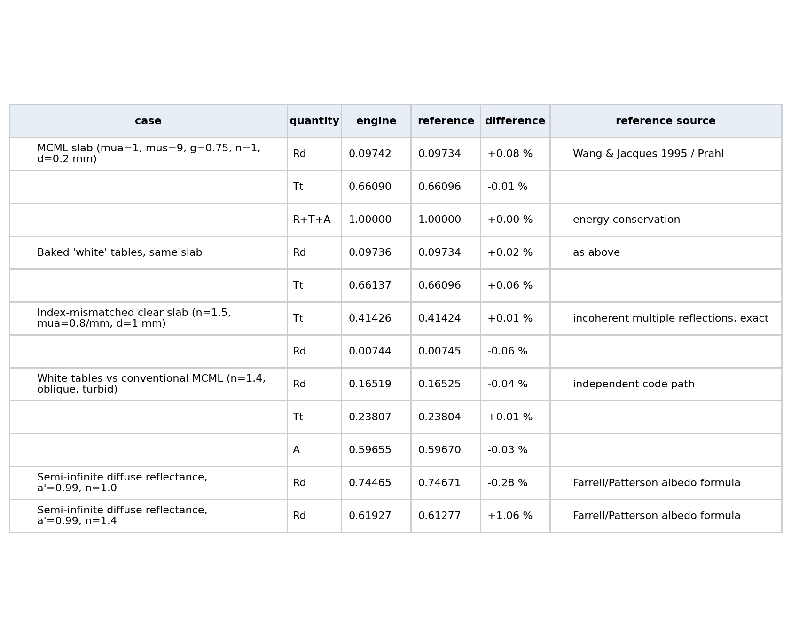

The baked "white" Monte Carlo tables (which every turbid-material kernel is built from) and a conventional
MCML implementation both reproduce the Wang–Jacques/Prahl slab benchmark (μₐ = 1, μₛ = 9 /mm, g = 0.75, n = 1,
d = 0.2 mm: R_d = 0.09734, T_t = 0.66096) to better than 0.1 %, conserve energy to 10⁻⁹, match the exact
incoherent multiple-reflection solution for a non-scattering index-mismatched slab (0.01 %), and agree with each
other for an oblique, index-mismatched turbid slab (≤ 0.05 %).  Semi-infinite diffuse reflectance agrees with
the Farrell–Patterson albedo formula within 0.3 % (n = 1) and 1.1 % (n = 1.4; the dipole formula itself is
only good to a few % at an index step).
*References:* Wang, Jacques & Zheng, *Comput. Methods Programs Biomed.* 47, 131 (1995); Prahl, *Light transport
in tissue*, PhD thesis, Univ. Texas (1988); Farrell, Patterson & Wilson, *Med. Phys.* 19, 879 (1992).

## 2. Diffusion limit

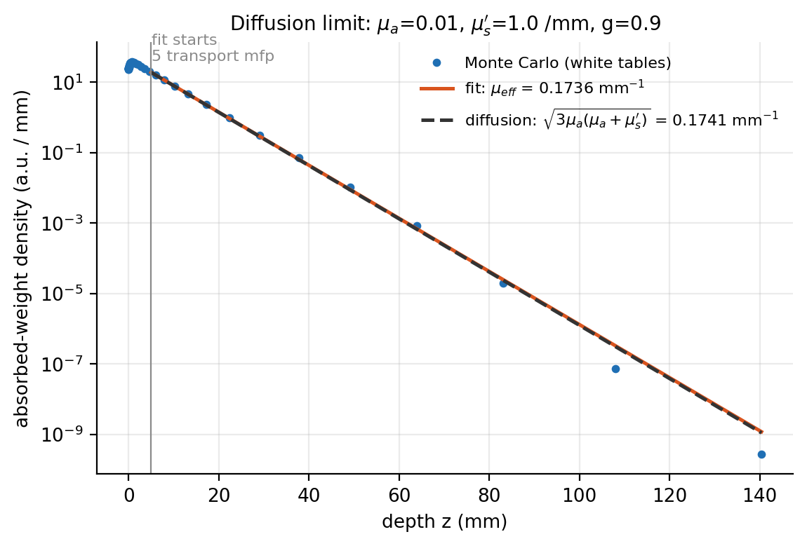

For a high-albedo semi-infinite medium (μₐ = 0.01, μₛ′ = 1 /mm, g = 0.9) the depth profile of absorbed weight
decays as exp(−μ_eff z) beyond a few transport mean free paths.  The fitted μ_eff = 0.1736 /mm differs by
−0.29 % from the diffusion value √(3 μₐ(μₐ+μₛ′)) = 0.1741 /mm, over nine decades of dynamic range.
*Reference:* Patterson, Chance & Wilson, *Appl. Opt.* 28, 2331 (1989).

## 3. Clear closed form vs. volume quadrature

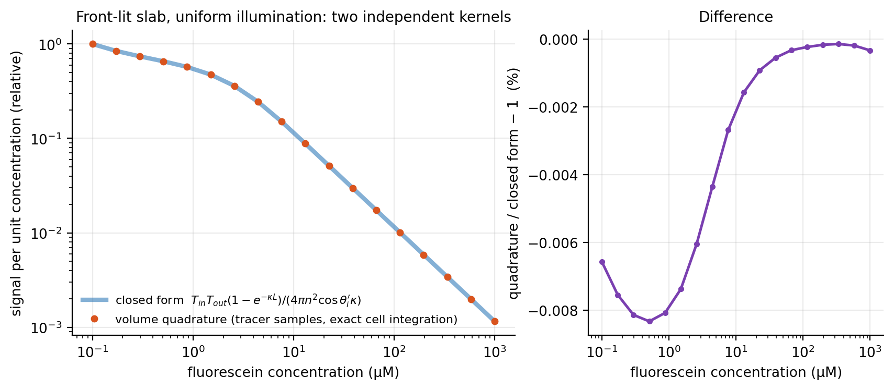

Two independent implementations of the same physics: the contract's closed-form kernel (front-lit slab,
laterally infinite) and the tracer's per-pixel volume samples (16 Gauss–Legendre nodes along the view chord,
excitation traced back to the source through the actual entry face), integrated cell by cell with exact
exponentials.  For a laterally uniform beam (300 mm flat-top on a 30 mm slab at 30° incidence) they agree to
**0.008 %** from 0.1 µM to 1 mM fluorescein, i.e. from the dilute limit to a 0.03 mm penetration depth.
(A plain 16-point rule fails by −70 % to +100 % for penetration depths below the first node, so the engine
integrates exactly per cell; see `capture._volumetric_G`.)  With a *finite* beam the two legitimately
differ: the quadrature knows that the refracted beam does not reach deep samples laterally displaced by
`depth·tanθ′`, the closed form assumes infinite illumination.

## 4. Dilute limit vs. the legacy 2-D engine

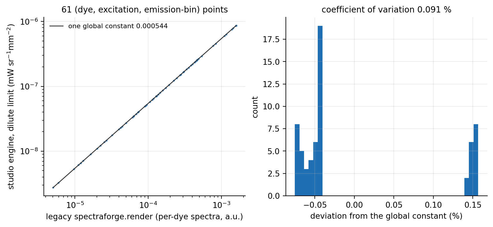

In the dilute limit the 3-D engine and the legacy `spectraforge.render` give the same per-dye emission shapes
and cross-excitation amplitude ratios up to a single geometry constant (61 dye × excitation × emission-bin
points, EGFP/mCherry/DAPI at 365–532 nm): coefficient of variation of the ratio **0.09 %**.  This ties the
new engine to the validated one used in the TPAMI work.

## 5. Inner-filter effect: front-face vs. 90° geometry

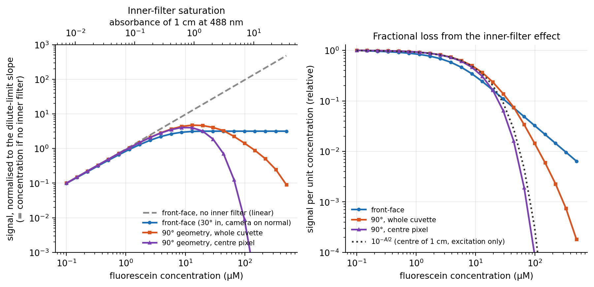

Fluorescein, 488 nm excitation, 0.1–500 µM, no self-quenching.  *Front-face* (camera on the surface normal,
beam at 30°): the signal per unit concentration falls as the penetration depth 1/μₜ shrinks and the curve
saturates at a plateau (Φ μₐ/(μₜ,ₑₓ·r + μₜ,ₑₘ), independent of c), the classic front-face behaviour.  *90°
geometry* (laser along x, camera along −z): the signal integrated over the cuvette peaks near 13 µM
(A₁cm ≈ 0.9) and then falls because the beam is absorbed before it reaches the cell; the signal at the *centre
pixel* peaks near 9 µM and falls as 10^(−A/2) (dotted), exactly the excitation-only prediction for the cell
centre.  *References:* Lakowicz, *Principles of Fluorescence Spectroscopy*, 3rd ed., §2.7 (2006);
Kubista, Sjöback, Eriksson & Albinsson, *Analyst* 119, 417 (1994).

## 6. Reabsorption (secondary inner filter): emission red-shift

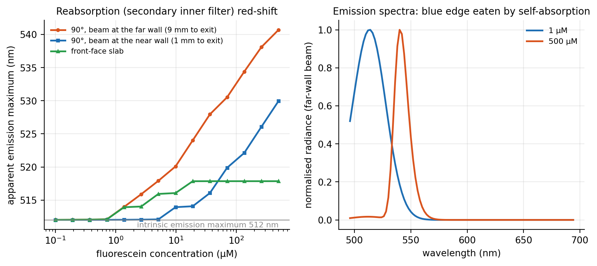

Fluorescein absorbs at the blue edge of its own emission.  The apparent emission maximum moves from
512 nm (dilute) to 540 nm at 500 µM when the emission has to cross 9 mm of liquid (beam at the far wall), to
530 nm for a 1 mm exit path and only to 518 nm for the front-face slab (exit path of order 1/μₜ).  Right: the
500 µM spectrum has lost its entire blue edge, as in measured high-concentration spectra.
*References:* Birks, *Photophysics of Aromatic Molecules* (1970), ch. 3; Lakowicz (2006) §2.7.

## 7. Photobleaching and acquisition order

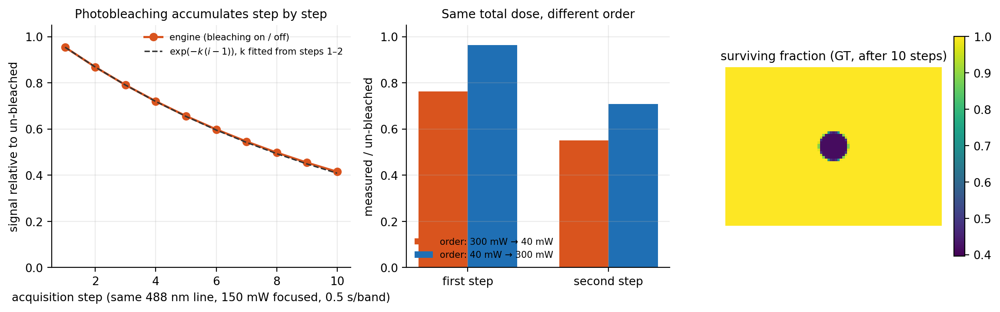

Per pixel, the dye survival is updated after every excitation step by *exp(−Φ_b · absorbed photons/molecule)*
(σ = ln10 ε/N_A, photon fluence at the illuminated surface, whole-sequence exposure), so the signal of a
repeated 488 nm step decays as exp(−k n) (left; k = 0.094 per step for 150 mW focused to a 6 mm spot, 7.5 s
exposure per step, Φ_b = 3·10⁻⁵).  The acquisition *order* matters (centre): with identical total dose, the
sequence 300 mW → 40 mW records 76 %/55 % of the un-bleached signals, 40 mW → 300 mW records 96 %/71 %.  The
survival map (right) is a ground-truth layer (`bleached:<dye>`).
*References:* Song, Hennink, Young & Tanke, *Biophys. J.* 68, 2588 (1995); Eggeling et al., *Anal. Chem.* 70, 2651 (1998).

## 8. Noise statistics: photon transfer curve

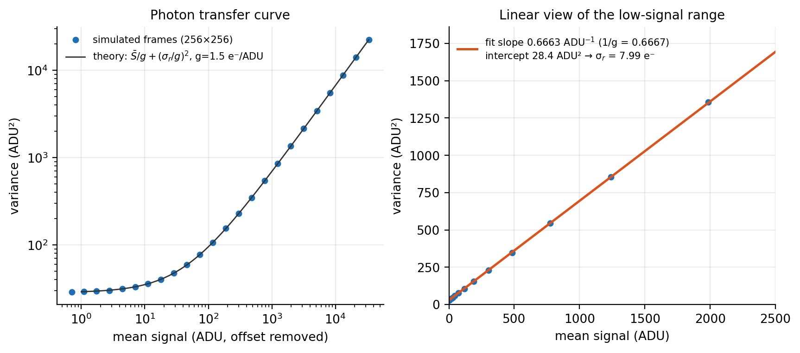

Uniform frames at 24 signal levels (256 × 256 px) through the detector model: the variance (ADU²) follows
*S̄/g + (σ_r/g)²* with the configured gain g = 1.5 e⁻/ADU; the fitted slope is
**1/g = 0.666 ADU⁻¹ (expected 0.667)**, i.e. a fitted gain of 1.501 e⁻/ADU (0.669 over the full range up to 3·10⁴ ADU),
and the read noise recovered from the intercept is 7.99 e⁻ (configured 8.0).  Shot noise is Poisson, read noise Gaussian, ADC quantisation adds 1/12 ADU².
*References:* Janesick, *Photon Transfer* (SPIE, 2007); EMVA Standard 1288.

## 9. Depth of field and defocus

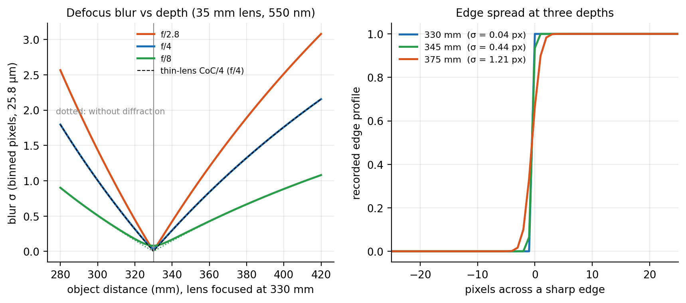

The blur σ (binned pixels) of an object off the focal plane follows the thin-lens circle of confusion
c = (f/N)·|v₁ − v₂|/v₂ (σ = c/4 for a uniform disc) with an Airy floor σ = 0.42 λ N (1+m) and an axial chromatic
focal shift; the black dashed curve is the analytic thin-lens CoC for f/4 and coincides with the engine.
Opening the aperture (f/2.8) or moving 45 mm from the 330 mm focal plane (σ = 1.2 px at f/4) visibly softens
an edge (right).  The blur is spatially and spectrally varying (per pixel depth, per band wavelength).
*References:* Smith, *Modern Optical Engineering*; Hecht, *Optics*; Born & Wolf, *Principles of Optics* (Airy PSF).

## 10. Filter angle blue shift across the field

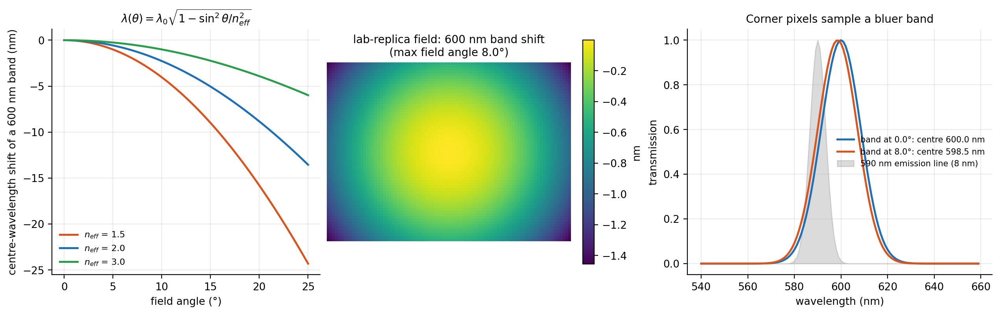

A ray at field angle θ sees an interference/LCTF stack tuned to
λ(θ) = λ₀√(1 − sin²θ/n_eff²) (n_eff = 2): a 600 nm band shifts by −1.5 nm at the corner of the lab-replica
field (θ_max = 8.0°; −13 nm at 25°).  The engine builds field-angle rings, each with its own band response
matrix, so the spectral calibration varies across the image, including for an emission line sitting on the
slope of a band.  *References:* Macleod, *Thin-Film Optical Filters*, 4th ed. (2010), §7.6;
Morris, Hoyt & Treado, *Appl. Spectrosc.* 48, 857 (1994).

## 11. Demonstration: `laser_line` preset (money shot)

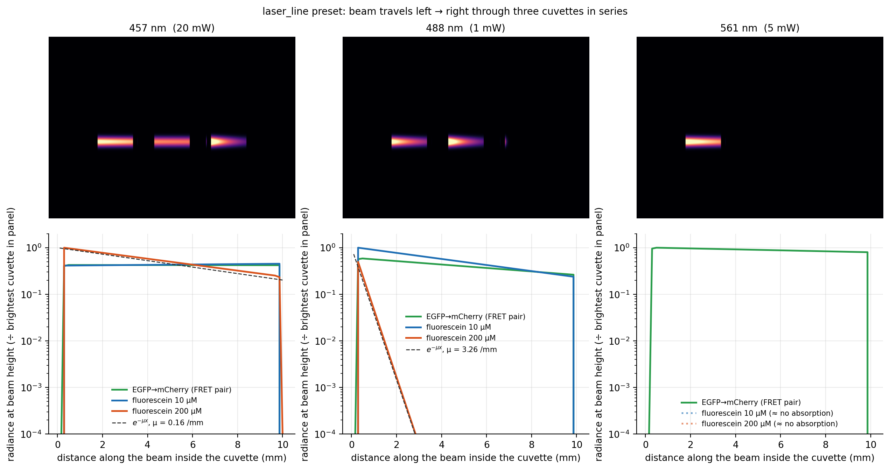

A 3 mm laser beam crosses three cuvettes in series and the camera looks sideways.  At 457 nm (blue wing of the
fluorescein band, ε ≈ 3.5·10³ M⁻¹cm⁻¹) the 200 µM cuvette shows a resolved inner-filter gradient (bright at the
entrance wall, ×5 weaker across 10 mm, μ = 0.16 /mm, dashed analytic curve); at 488 nm the same cuvette absorbs
everything within 0.3 mm (thin bright sliver of front-face emission, μ = 3.3 /mm) while the 10 µM cuvette decays
exponentially across the cell; at 561 nm only the mCherry of the FRET pair is excited.  The beam arriving at each
cuvette is attenuated by the ones before it (Beer–Lambert through the earlier cuvettes).

---


## 12. Layered blocks (3D Monte Carlo)

A `layered_block` (substrate, fluorescent layer, cover; uniform or linear-wedge thickness, exact planar interfaces)
is not evaluated with the 1-D kernels: its pixels get their radiance from an explicit three-dimensional photon
random walk (`transport3d`, MCML generalised to tilted planar interfaces), run once per excitation line and once
per emission wavelength node with all fluorescence channels in the same pass (`block_capture`).  Section 12.1 to
12.6 are regenerated by `scripts/studio_validation_figures.py --only blk_validation,blk_bottom,blk_peel,blk_wedge,blk_field`.

### 12.1 The 3D engine against MCML and the 1-D engine

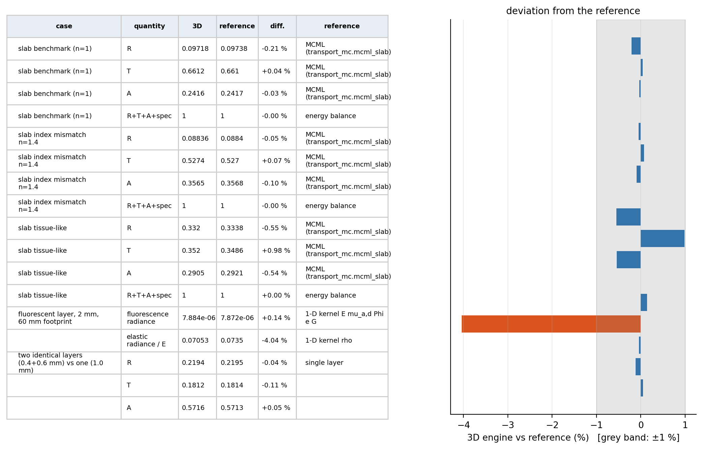

Homogeneous slabs (200 mm footprint, wide normal beam) reproduce the conventional MCML code of this repository
for diffuse reflectance, transmittance and absorption (benchmark slab R -0.21 %,
T +0.04 %; index-mismatched slab R -0.05 %,
T +0.07 %; tissue-like slab R -0.55 %, T +0.98 %, A -0.54 %; the remaining differences are Monte Carlo noise), energy is conserved
to 1e-9 (R+T+A+specular+roulette bookkeeping), two identical stacked layers equal one layer of the summed thickness
(R -0.04 %, T -0.11 %),
and a 2 mm fluorescent layer (60 mm footprint) gives the 1-D kernel result
`E mu_a,dye Phi e G` to +0.14 % (fluorescence)
and -4.04 % (elastic remission).

### 12.2 Bottom boundary: Fresnel to air, transmitted light lost

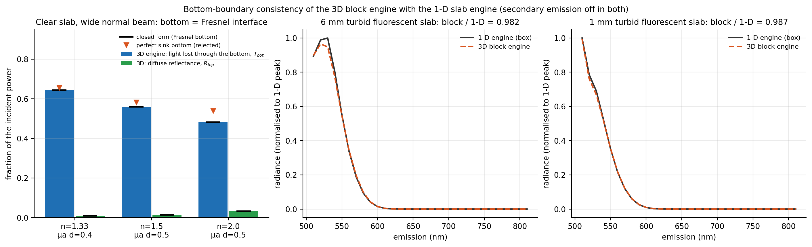

The bottom face of a block, like its four sides, is a Fresnel interface to air (`n = 1`): the transmitted part
`w (1 - R)` leaves the block (it is absorbed by the stage and tallied as `T_bottom`, it never returns) and the
reflected part `w R` (total internal reflection included) stays in the block.  This is exactly the 1-D slab
engine's assumption (`n_outside` on BOTH faces of a finite slab).  A perfect sink bottom would differ visibly:

| n | mu_a d | T_bottom (3D) | closed form | R_top (3D) | closed form |
|---|---|---|---|---|---|
| 1.33 | 0.40 | 0.64381 | 0.64381 | 0.00866 | 0.00866 |
| 1.5 | 0.50 | 0.55931 | 0.55931 | 0.01357 | 0.01357 |
| 2.0 | 0.50 | 0.48142 | 0.48142 | 0.03244 | 0.03244 |

(clear slab, closed form `T = (1-R0)^2 e^-tau / (1 - R0^2 e^-2tau)`, `R_top = (1-R0)^2 R0 e^-2tau / (1 - R0^2 e^-2tau)`.)
Turbid fluorescent slabs captured as a block and as a 1-D box (secondary emission off in both, same lamp, same
camera, slab standing above the stage plane) agree: **6 mm** block/1-D = 0.982, **1 mm** = 0.987
for the band-integrated fluorescence.  *A caveat that cost a diagnosis:* a slab that straddles the stage plane
`y = 0` makes the 1-D tracer measure its thickness only down to the plane (half of it), which looks like a 25 to 90 %
"bottom-boundary" disagreement; it is a test-geometry artefact, not a property of either engine.  Thick slabs (about
20 mm) differ by up to 20 % in the red tail for a real 3D reason: the 1-D engine assumes laterally uniform irradiance,
the block sees the finite 10 mm lamp spot and the diffuse light escapes sideways.

### 12.3 Peel-off (next-event) estimator versus the acceptance-cone estimator

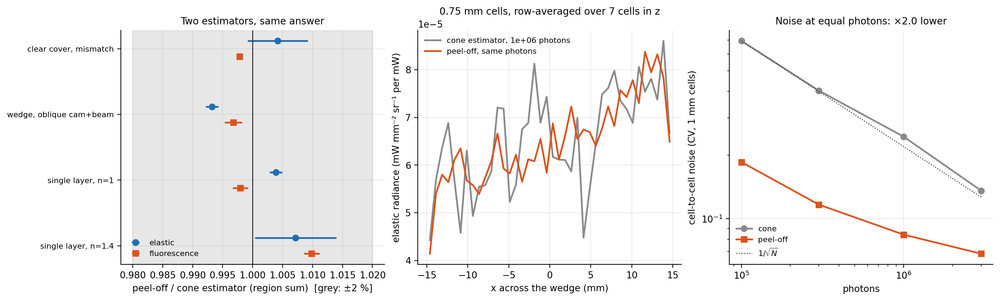

The first implementation counted only packets that happen to leave the top face inside the 12 degree camera cone,
which is very noisy for the small cells needed to resolve a wedge, so the face tally was blurred with a
Gaussian of 0.75 mm sqrt(2e6/N) (2.4 mm in a preview).  `transport3d` now adds, at every scattering event (and at the
launch of an emission packet), the expected contribution of the straight line of sight to the camera: the internal
direction follows from the inverse of Snell's law through the (tilted) interface chain, the weight is
`w p_HG T e^-tau J` with `J = dOmega_in/dOmega_air = prod n_up^2 cos_up / (n_in^2 cos_in)` (etendue), and a
multiple-importance-sampling (balance heuristic) weight `1/(1 + Omega_c p J)` bounds the forward-peaked phase
function tail.  The derivation is in the `transport3d` docstring.  Agreement with the cone estimator (region sums,
5 mm cells, 3e6 photons, two seeds; the cone estimator itself has an `O(theta_a^2)` ~1 % bias against a point radiance):

| configuration | elastic: peel / cone | fluorescence: peel / cone |
|---|---|---|
| single layer, n=1.4 | 1.007 | 1.010 |
| single layer, n=1 | 1.004 | 0.998 |
| wedge, oblique cam+beam | 0.993 | 0.997 |
| clear cover, mismatch | 1.004 | 0.998 |

Cell-to-cell noise of a uniform field (1 mm cells, single layer n = 1.4, g = 0.8):

| photons | cone | peel-off | std reduction |
|---|---|---|---|
| 100,000 | 0.693 | 0.185 | x3.7 |
| 300,000 | 0.404 | 0.117 | x3.5 |
| 1,000,000 | 0.244 | 0.084 | x2.9 |
| 3,000,000 | 0.136 | 0.068 | x2.0 |

The gain depends on the scattering anisotropy (at equal photons the std reduction is about 6x for g = 0 and 2x for
g = 0.9) and each peel-off event costs more than a cone tally, so the net saving at equal time is ~2x on the presets;
the larger part of the speed-up comes from needing fewer photons at all (section 12.7).

**Smoothing.**  The peel-off tally is still noisy at the default (reduced) photon count, 21-23 % per 0.5 mm cell,
so the top face is smoothed by a SUB-CELL Gaussian, `block_capture.SMOOTH_SIGMA_MM = 0.35` mm (0.7 cell, FWHM 0.8 mm), instead of the
old 0.75 mm sqrt(2e6/N) (2.4 mm at preview).  Measured on `layered_wedge_phantom` (two seeds, rms difference of the band-summed
radiance of the central block pixels): old cone estimator at 2e6 photons with 0.75 mm smoothing 3.2 %; peel-off at 4e5 photons: sigma 0 gives 7.2 %,
0.25 mm 5.3 %, **0.35 mm 3.9 %**, 0.5 mm 3.0 %; peel-off at 2e6 photons without smoothing 3.3 %.  So 0.35 mm gives the old noise
level with 5x fewer photons and a 2x narrower kernel (the radiance field itself is blurred by the transport mean free path, ~0.7-1 mm
in these media).  `SMOOTH_SIGMA_MM = 0` switches it off; side faces keep the old adaptive smoothing (cone estimator).

### 12.4 Buried fluorophore under a wedge cover

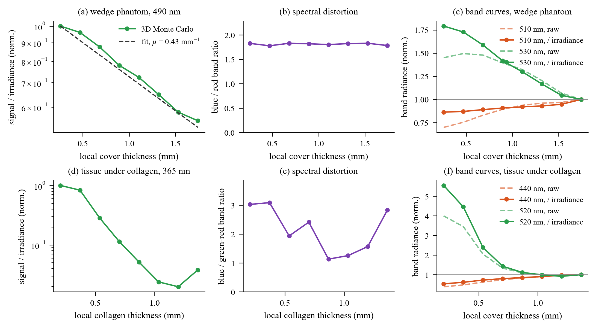

`layered_wedge_phantom` (fluorescein layer under an intralipid-like cover thinning from 2 mm to 0): the buried
signal per unit surface irradiance falls roughly exponentially with the local cover thickness (effective
attenuation 0.43 /mm at 490 nm excitation, 495 to 525 nm emission).  The blue/red ratio
of the buried emission (495-525 / 535-560 nm) stays between 1.78 and 1.83 (a 3 % spread without trend, shown on a full-scale axis; fluorescein now has its realistic red tail, `em_skew = 0.4`, `vibronic = 0.2`, so the ratio is 1.8 instead of the 5.3 of the earlier pure-Gaussian emission): this cover (water plus weak
scattering) is spectrally almost neutral across the fluorescein band, so the wedge phantom shows attenuation, not distortion.
`tissue_under_collagen` (NADH/FAD tissue under collagen, 365 nm) shows both: the buried tissue signal falls by more than an
order of magnitude between 0.20 and about 1 mm of collagen, and its 440 nm band drops less than the 520 nm band
(right panel), i.e. the cover filters the green side more strongly; the blue/green ratio panel is noisy
(8 pixels per bin, buried signal is only a few percent of the total under thick collagen) and should be read as a trend.
(Pixels within 12 % of the block width of the edges are excluded: light escapes through the side faces there.)

**Which band to use.**  Right-hand panels: the first band behind the excitation line (ex+20 nm) mixes the elastic leak
of the line through the LCTF passband (which RISES with cover thickness, the cover being a diffuse reflector) with the
fluorescence (which falls), so its curve is flat or even increasing, and the raw radiance is also confounded by the lamp.
At ex+40 nm the elastic term is below 1e-5 of the fluorescence and, divided by the surface irradiance, the curve is
cleanly monotonic (x1.8 from 1.74 to 0.26 mm).  A uniform-cover control (same preset, cover 1.0 mm everywhere) shows the lamp
confound: the raw 530 nm band radiance drifts by 32 % across the block (irradiance gradient plus the lateral loss within the last
~10 % of the width), after dividing by the ground-truth surface irradiance it drifts by 7.6 % (5e6 photons, 8 bins), small against the x1.8 wedge
effect; the preset therefore does not need to move the lamp, but analyses should use an irradiance-normalised metric
(or the white-reference mode).

### 12.5 Light field inside the block

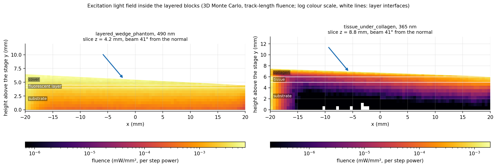

Track-length fluence of the excitation light, in a vertical slice through the beam centre, in physical coordinates
(mm), log colour scale, interfaces drawn.  The lamp beam arrives 41 degrees from the normal;
the fluence penetrates as a banana-shaped plume that is dragged along the beam direction by the forward-peaked
scattering (g = 0.8 to 0.9) and is attenuated by the absorbing buried layer; the peak fluence is
6.8e-03 mW/mm^2 (wedge phantom, 490 nm step) and 1.9e-03 mW/mm^2
(tissue, 365 nm step).  The plume is wider than the beam: that lateral spreading is what the 1-D engine
cannot represent.  (The figure shows the lamp-lit phantoms; the pencil-beam preset's own light field, a 1 mm beam whose fluorescence spot is broadened to about 3.4 mm FWHM, is in USER_GUIDE section 12.  Its plume is a teardrop that leans only slightly along the beam: the tissue's reduced scattering of 1.2 to 2 /mm randomises the direction within 2 to 3 mm.)

### 12.6 Collagen autofluorescence versus collagen thickness

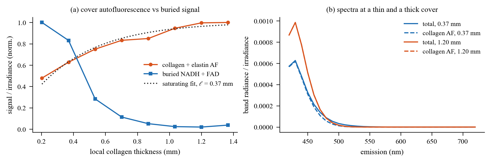

The cover's own (collagen plus elastin) autofluorescence grows with its thickness and saturates
with a decay length of 0.37 mm
(excitation is attenuated on the way in and the emission on the way out, so only the top ~ell contributes), while
the buried NADH/FAD signal falls: with the Explore tools one can read the thickness at which the cover signal exceeds
the tissue signal.

### 12.7 Speed and settings

Photon counts of `volume_mc` are scaled by `block_capture.PEEL_PHOTON_FACTOR = 0.2` when the peel-off estimator is on
(4e5 photons per pass at the defaults).  Emission nodes are placed adaptively (never more than the uniform grid; 9 instead of 14
where the transport factor is smooth).  Peel-off events that cannot reach the camera (vertical optical depth to the top above 14) are skipped
(2x faster kernel).  Wall clock on a machine that was NOT idle (load average 20-35 from other jobs), same experiments, same machine state:

| | before | after |
|---|---|---|
| `layered_wedge_phantom` preview | 6.0 s | 2.3 s |
| `layered_wedge_phantom` full capture (6 excitations) | 106 s | 45 s |
| `tissue_under_collagen` preview | 8.0 s | 3.8 s |
| `tissue_under_collagen` full capture (8 excitations) | 116 s | 61 s |

(measured earlier at lower load, after: 1.6 / 31 / 2.6 / 48 s.)  Explain of a block pixel after a preview: 20-60 ms (cached Monte
Carlo; it used to re-simulate the whole sequence, ~10 s); 64 pixels: 1.5 s.

### 12.8 Limitations of the block model

* **No secondary emission for blocks.**  Fluorescence re-absorbed inside the block is lost, it is not re-emitted
  (the 1-D engine adds one generation).  Around the absorption/emission overlap the block is therefore a few percent
  to ~10 % dimmer than the 1-D engine for strongly overlapping dyes (fluorescein); with `secondary_emission` off in both
  engines they agree (12.2).
* **One camera direction per block.**  The radiance is tallied in a 12 degree cone around the direction from the
  block centre to the camera.  Wide-field cameras close to a block see a small angular error across the field; a
  perspective view of the block's side faces uses the cone estimator and is noisier than the top face.
* **Planar-interface geometry.**  Interfaces are exact planes (uniform or linear wedge), the footprint is a rectangle
  with four vertical sides; curved or rough interfaces, inclusions and lateral material changes are not representable.
  Interface roughness is a specular-glint property of the tracer, not of the transport.
* **Subsurface spread, room light and `secondary_emission` are not applied to block pixels** (the 3D transport already
  contains the lateral spreading); photobleaching is resolved per voxel; the bottom boundary is a Fresnel interface
  to air (stage absorbs, never reflects).
* **Fluorescein emission** uses `em_skew = 0.4`, `vibronic = 0.2` (red tail of the real dianion: about 36 % of the peak at 550 nm and 12 % at 570 nm); the 12.4 figures were regenerated with it.
* **The 3D result is a Monte Carlo estimate.**  The default photon counts give ~10 % rms noise per 0.5 mm face cell
  before the sub-cell smoothing; 2-3 % in a 3 mm region of interest.

---

## 13. Approximations and limitations (honest list)

* **`indirect_bounce` is not implemented (v1).**  The toggle exists in the schema but no engine code reads it; the
  web inspector shows it disabled ("not yet implemented (v1)").  There are no diffuse interreflections between
  objects and the table.
* **Spectra are parametric.**  Absorption and emission bands are Gaussians (emission with skew and an optional
  vibronic shoulder).  Consequences: no S₀→S₂ absorption band, so fluorescein absorbs *nothing* at 405 nm in the
  model (real ε(405) ≈ 3 % of the 490 nm peak); absorption and emission are not exact mirror images; solvent
  shifts are not modelled.  Extinction maxima of fluorescein, mCherry, mKate2, DAPI (DNA-bound), EBFP2, NADH
  and FAD are literature values (`presets._EXTINCTION_MCM`); the other dyes keep the 2-D library's relative values.
* **Scattering:** power-law μₛ′(λ) with one Henyey–Greenstein g per material, no wavelength-dependent g, no
  polarisation, no coherent effects, no fluorescent scattering particles.  The bake assumes the bottom face of a
  finite slab borders the same medium as the top; elastic remission is azimuth-averaged.
* **Fluorescence:** Stern–Volmer self-quenching with a single K_sv, FRET as a concentration-dependent efficiency
  E = kc/(1+kc) (no spectral-overlap integral, no orientation factor), secondary emission is one generation with
  isotropic re-emission, water Raman only for the 3400 cm⁻¹ O–H band, no lifetimes, no depolarisation, no
  temperature dependence, no triplet saturation (a single absorbed-photon dose model for bleaching).
* **Photobleaching** uses the surface photon fluence (times a 1 + 2πρ build-up for turbid media) for the dose;
  it is not depth-resolved.
* **Geometry/optics:** one specular bounce (GGX) and an optional diffuse bounce (off by default); shadow rays
  are straight lines to the source aperture (no lateral shift through glass); no interreflections between objects,
  no lens distortion, no ghosts/flare/stray light, no cos⁴ beyond the field angle model; filter incidence angle
  is the object-space chief-ray angle (pupil magnification neglected).
* **Subsurface spread** convolves each turbid material within its own mask: light that diffuses out of a small
  object is lost instead of being re-emitted into the neighbours (visible for a 14 mm agarose bead whose
  transport mean free path is 4 mm).
* **Volume quadrature (side-lit clear media)** uses 16 nodes per chord; at the soft edge of a finite beam the lit
  fraction of the chord is quantised to ~6 % steps, which shows as a faint ripple (≈ ±3 %) at the beam footprint
  boundary in oblique illumination.
* **Band shapes:** LCTF passbands are Gaussian (≈ 1 % transmission one FWHM away), interference filters are
  super-Gaussian (order 6) with an OD 4 floor; real LCTFs have side lobes and a wavelength-dependent FWHM.
* **Detector:** Poisson shot noise, Gaussian read noise, PRNU/DSNU, hot pixels, full well, quantisation;
  no blooming, no charge-transfer inefficiency, no non-linearity near saturation, no rolling shutter.
* **Tracer limit:** a shadow ray may cross at most 8 interfaces (raised to 16 by `capture` as a workaround);
  see `tests/studio/test_qa_findings.py`.
