# SpectralForge Studio: user guide

A walkthrough of the interface for people who will use Studio to design virtual multi-excitation hyperspectral experiments, simulate them, and look at the result. It assumes no programming. For *what the simulation computes* read [HOW_IT_WORKS.md](HOW_IT_WORKS.md); to install and start the program see the [README](README.md).

## Contents

1. [The layout](#1-the-layout)
2. [The workflow: Design, Acquire, Explore](#2-the-workflow-design-acquire-explore)
3. [Building an experiment](#3-building-an-experiment)
4. [Physics toggles](#4-physics-toggles)
5. [Preview, Capture, Dark, White reference](#5-preview-capture-dark-white-reference)
6. [The Explorer](#6-the-explorer)
7. [Exports and loading them in the existing pipeline](#7-exports-and-loading-them-in-the-existing-pipeline)
8. [Keyboard shortcuts](#8-keyboard-shortcuts)
9. [The guided tour](#9-the-guided-tour)
10. [Offline (mock) mode](#10-offline-mock-mode)
11. [Tips for demos and projectors](#11-tips-for-demos-and-projectors)
12. [Layered blocks (v1.1)](#12-layered-blocks-v11)
13. [The analysis workspace (v1.1)](#13-the-analysis-workspace-v11)
14. [Using a capture in a notebook](#14-using-a-capture-in-a-notebook)

---

## 1. The layout

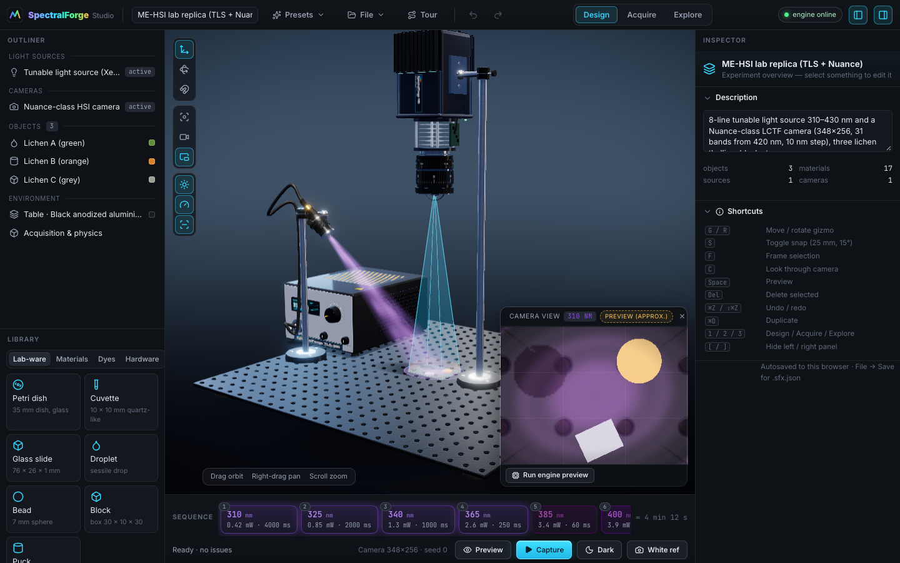

| Area | What it is |
|---|---|
| **Top bar** | Logo; experiment **name** (editable); **Presets** menu; **File** menu (open / save `.sfx.json`, new from the generic bench, restore autosave); **Tour**; undo and redo; the **Design / Acquire / Explore** mode switch; the engine badge (green "engine online", or amber "engine offline — mock data"); buttons to hide the left panel and the inspector |
| **Outliner** (top left) | The scene as a list: light sources, cameras, objects (with a colour swatch of their material and an eye icon to hide them), and the environment (table and the **Acquisition & physics** entry). Click to select; hover icons duplicate or delete |
| **Library** (bottom left) | Four tabs: **Lab-ware** (petri dish, cuvette, glass slide, droplet, bead, block, puck), **Materials**, **Dyes**, **Hardware** (tunable lamp, LED array, laser, HSI camera). Click an item or drag it into the viewport |
| **Viewport** (centre) | The 3D bench. Drag to orbit, right-drag to pan, scroll to zoom. A toolbar on the left holds the move/rotate gizmo and snap, frame, look-through-camera, picture-in-picture, show-beam, render quality and show-frustum buttons. The **Camera view** window (bottom right of the viewport) shows what the HSI camera sees |
| **Inspector** (right) | Properties of whatever is selected: object, material, source, camera, background and room light, or acquisition and physics. With nothing selected it shows the experiment description and a shortcut list. Live plots (line positions against dye absorption, passbands, spectra) are part of the inspector |
| **Sequence bar** (bottom) | The excitation sequence as coloured chips (wavelength, power, exposure), an estimate of the acquisition time, the status line (progress, warnings), and the buttons **Preview**, **Capture**, **Dark**, **White ref** |

Panels can be hidden with `[` and `]` to give the viewport the whole window.

## 2. The workflow: Design, Acquire, Explore

The three modes (top bar, or keys `1`, `2`, `3`) are three views of the same session.

1. **Design** (`1`). Choose a preset or start from an empty bench. Add samples, assign materials and dyes, place and aim the source and the camera. The viewport is a real-time approximation; the Camera view shows a quick GPU rendering of what the camera would see ("Preview (approx.)").
2. **Acquire** (`2`). The same viewport with the sequence bar in focus. Check the excitation sequence (order, power, exposure), press **Preview** to run the *physics engine* on one excitation at reduced resolution (about a second), fix any warnings, then press **Capture** to simulate the whole sequence. A progress bar shows the stage ("simulating 365 nm (4/8)", "sensor ..."), the estimated time left and a **Cancel** button. The beam in the 3D view takes the colour of the line currently being simulated.

   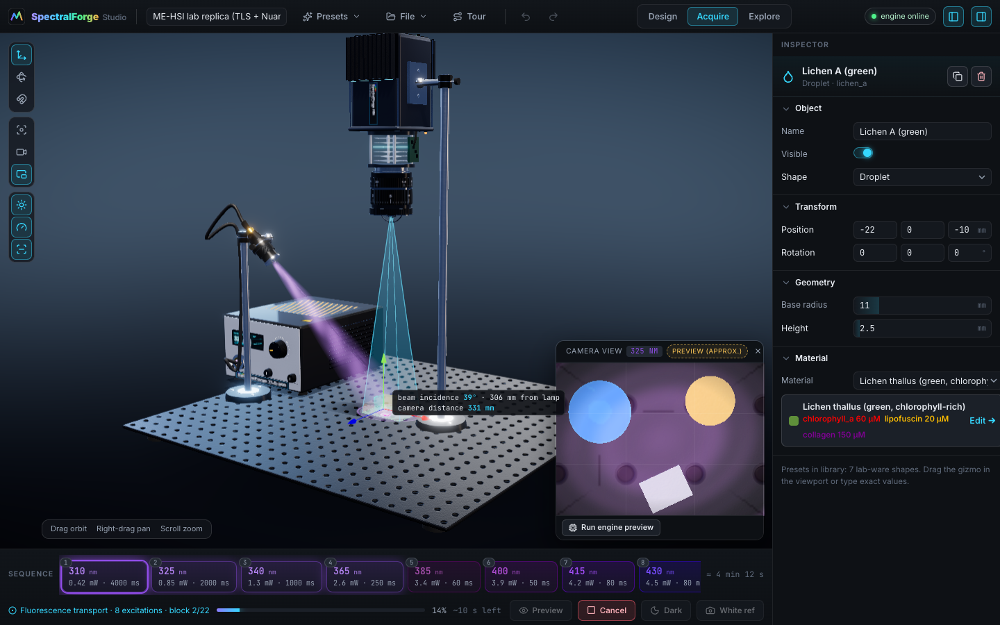

3. **Explore** (`3`). Every preview and capture of this session appears in a list on the left. Open one and look at the 4D cube (excitation × emission × y × x): scrub through bands, decompose single pixels into their physical components, overlay ground truth, compare two captures, export.

   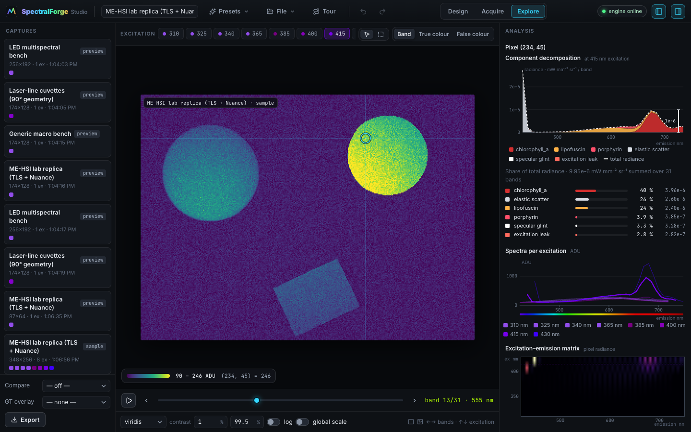

**Presets** (top bar, *Presets* menu) load a complete, working experiment:

| Preset | What it shows |
|---|---|
| **ME-HSI lab replica** (default) | The lab's instrument: an 8-line tunable source (310 to 430 nm, with the lab's exposure protocol) and a Nuance-class LCTF camera (348 × 256 pixels, 31 bands from 420 nm in 10 nm steps), three lichen thalli (green, orange, grey) on a black anodised stage |
| **Generic macro bench** | A top-down camera and an oblique tunable lamp over mixed samples: a petri dish with a tissue phantom, a fluorescein droplet, an EGFP agarose bead, an mCherry cuvette and a brightened paper card (a deliberate confound) |
| **LED multispectral** | A 6-channel LED array and a filter-wheel sCMOS camera (10 bands) over the same bench |
| **Laser line, side view** | The classic fluorometer geometry: a laser beam crossing three cuvettes in a row (FRET pair, dilute fluorescein, 200 µM fluorescein) viewed at 90°; shows the inner-filter effect |

Loading a preset replaces the current experiment (undo restores it). Your work is autosaved in the browser; **File > Save .sfx.json** (`Cmd/Ctrl+S`) saves the complete experiment as a file you can open later or give to a colleague, and **File > Open .sfx.json** loads it.

## 3. Building an experiment

### 3.1 Add, move, aim

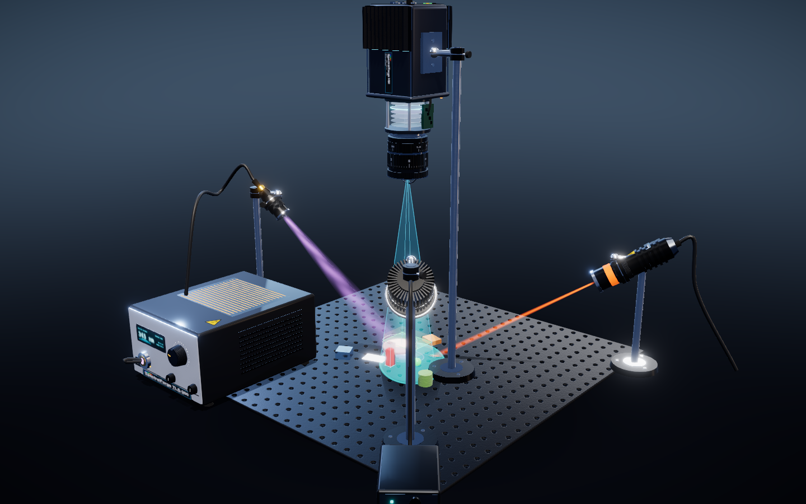

* **Add**: click an item in the Library, or drag it into the viewport (it lands where you drop it on the table). **Lab-ware** items are objects; **Hardware** adds a light source or a copy of the camera.
* **Select** in the outliner or by clicking in the viewport. The inspector shows its properties.
* **Move / rotate**: press `G` (move) or `R` (rotate) and drag the gizmo; or type exact values into the *Pose* / *Transform* fields of the inspector. `S` toggles snapping to a 25 mm grid and 15° steps. Units are millimetres; the table top is `y = 0`.
* **Aim** sources and cameras: select one and drag the round **target handle** at the end of its aim line (hold `Shift` to drag vertically), or type the *Target* coordinates. Sources and cameras are posed by *position* + *target* + *roll*.
* **Frame** the selection or the whole bench with `F`. **Look through the camera** with `C` (the viewport shows the camera's exact field of view, with thirds lines; `C` or `Esc` leaves). Toggle the **frustum** button to see the focus plane, the field of view and the depth of field slab.
* `Cmd/Ctrl+D` duplicates, `Delete` removes, `Cmd/Ctrl+Z` and `Shift+Cmd/Ctrl+Z` undo and redo. Hide an object with the eye icon without deleting it.

### 3.2 Objects, materials and dyes

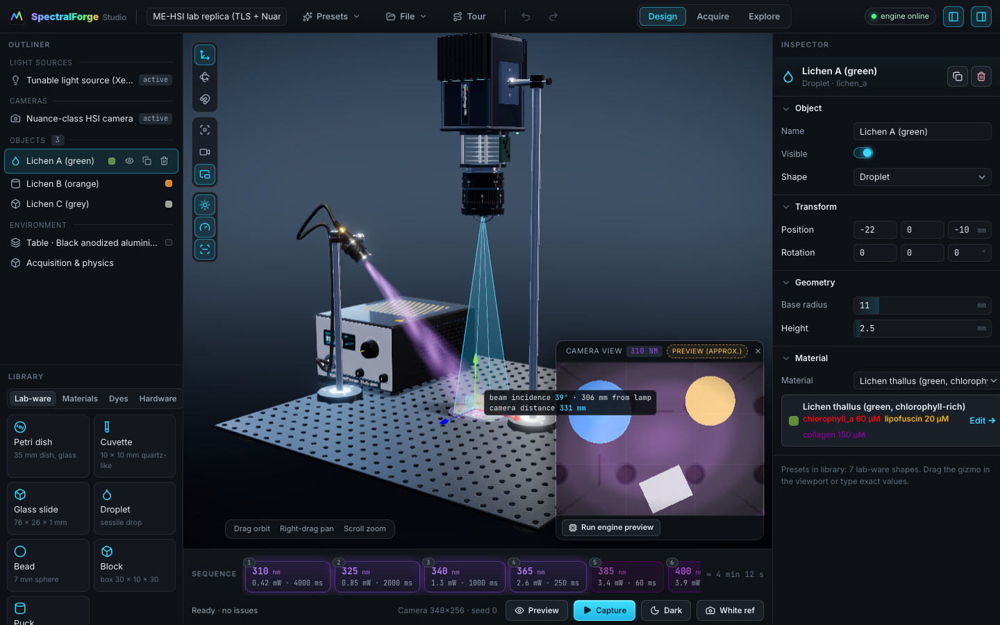

An **object** (inspector *Object* section) has a name, a shape and its dimensions (box, sphere, cylinder, droplet, petri dish, cuvette), a transform and a **material**. Petri dishes and cuvettes are *vessels*: a glass shell filled with the object's material up to a fill height; the vessel material (default glass) is separate.

A **material** is a uniform optical medium. Select an object and click *Edit* next to its material, or pick a material in the outliner's Library. In the material inspector:

* **Fluorophores**: the dyes in the material and their concentrations in µM. Add a dye from the **Dyes** tab of the Library (it is added at 10 µM to the selected object's material). Each dye is a Gaussian absorber/emitter; the absorption coefficient follows from the concentration, so doubling the concentration doubles the absorption.
* **Optics**: refractive index; **scattering** (none, or a reduced-scattering power law with its value at 500 nm, exponent, and anisotropy *g*); a **background absorber** (water, haemoglobin, melanin, carbon black or a custom table) with a scale.
* **Surface & photophysics**: roughness (specular glints), *aqueous* (adds the water Raman band), Raman strength, the Stern-Volmer **quenching** constant (self-quenching at high concentration).
* **FRET pairs**: donor, acceptor and an efficiency constant.
* **Spectral view**: plots of the dyes' absorption and emission.

A material used by several objects is shared; editing it changes all of them. Practical rules of thumb: for a *clear* liquid (dye in water or buffer) leave scattering at *none*; for tissue, gels, paper or lichen set a scattering power law; for a stage or card use the matching builtin material. Even "surfaces" are volumes in this model (white paper is a scattering volume with an optical brightener).

### 3.3 The light source and the sequence

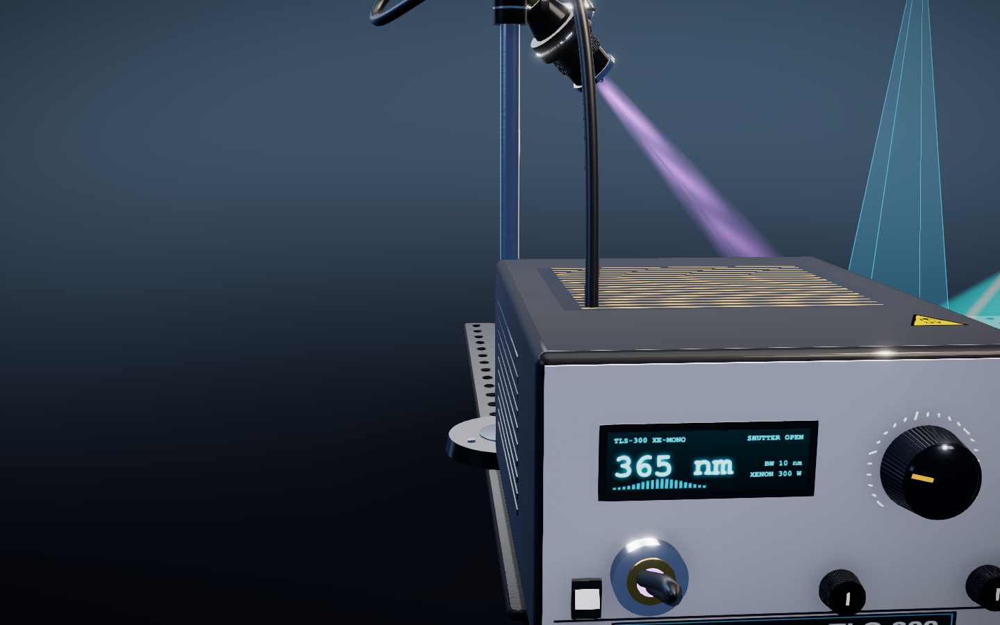

Select the source (outliner or viewport). Sections:

* **Source**: type (**tunable lamp** = xenon arc with a monochromator, **LED array**, **laser**), name, *Active* (only the active source is simulated).
* **Pose**: position, target, roll.
* **Beam**: Gaussian or flat-top profile, the aperture diameter at the exit, the divergence half-angle. The irradiance falls with distance (inverse square) and the beam is visible in the viewport as a volumetric cone, coloured by wavelength (ultraviolet and infrared lines are drawn as a violet shimmer because you cannot see them).
* **Spectrum** (collapsed by default): *line FWHM* (monochromator band-pass / LED width / laser line width), *lamp curve* (xenon or flat), the optical density of the **excitation clean-up filter** (out-of-band leakage is `10^-OD`), and the step-to-step **power drift** (%).
* **Excitation sequence**: a table of excitation steps: wavelength (nm), power (mW), exposure (ms), enabled, and move up/down. The order matters because photobleaching accumulates step by step: a high-power UV step early on bleaches the sample for everything after it. The sequence bar at the bottom shows the same steps as chips: click a chip to choose which line **Preview** simulates (and the beam colour); double-click a chip to enable/disable it; the **+** button appends a step. The "≈ 4 min 12 s" figure estimates the real acquisition time (exposure × bands plus filter retuning).
* **Lines vs. dye absorption**: a plot of the sequence lines over the absorption of every dye in the scene: use it to check that each line excites something.

### 3.4 The camera and its filters

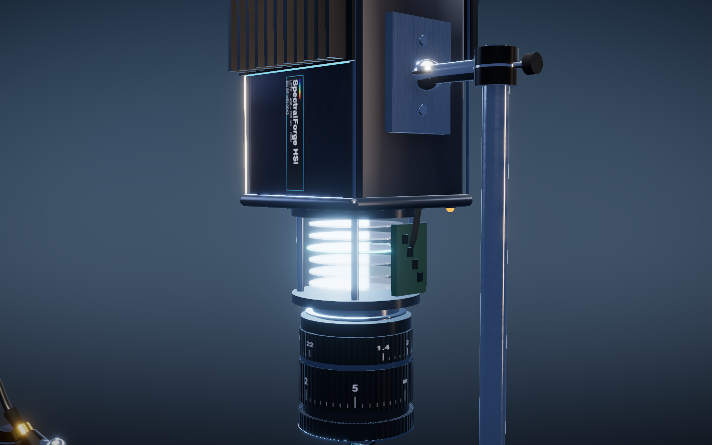

Select the camera. Sections:

* **Pose** (position, target, roll); the readout at the top gives the vertical field of view, the field size on the sample, the pixel size on the object and the depth of field.
* **Lens**: focal length, f-number (aperture: depth of field and diffraction), focus distance, transmission, axial chromatic shift.
* **Sensor** (collapsed by default): width and height in (binned) pixels, pixel pitch and **binning**, QE curve (CCD blue/UV, sCMOS, flat), bit depth, full well, read noise, dark current, gain (e⁻/ADU), offset, PRNU, DSNU, hot-pixel fraction.
* **Spectral filter**: *LCTF* (liquid-crystal tunable filter, Nuance-like) or *filter wheel* (interference band-pass filters); first band, step and number of bands; passband FWHM; **start policy**; peak-transmission curve; the emission **long-pass** edge and its optical density. With the start policy *excitation offset* (the real Nuance protocol), the band list starts at the larger of the first band and *excitation + offset*, so the bands never include the excitation line itself: with 430 nm excitation and a 20 nm offset the cube starts at 450 nm.
* **Passbands · QE · long-pass**: a plot of the bands and the detector curve.

### 3.5 Background and room light

Select **Table** in the outliner (environment). *Kind*: **plane** (a slab of a chosen material under the samples, with thickness and extent; the default is black anodised aluminium) or **none** (rays that miss every object return nothing). **Room light**: switch on ambient light and choose its spectrum (fluorescent tube, white LED, daylight, incandescent) and its illuminance in lux. A fluorescent tube has mercury lines (405, 436, 546, 578 nm) that leak into the bands, which is exactly why real experiments are run in the dark: use it to see what a light leak looks like in the data.

## 4. Physics toggles

Select **Acquisition & physics** in the outliner. The inspector shows:

* **Run**: the acquisition **mode** (Sample, Dark, White reference), the random **seed** (same seed gives an identical result), **MC photons** (quality of the Monte Carlo transport tables; more is smoother and slower the first time, then cached) and the **preview scale** (resolution fraction used by Preview, default 0.25).
* 26 on/off **effects** in four groups: *Light transport* (fluorescence, absorption, scattering, elastic leak, Raman, Fresnel, specular glints, shadows, subsurface spread, indirect bounce), *Photophysics* (secondary emission, quenching, FRET, photobleaching, power drift), *Optics* (defocus, diffraction, chromatic aberration, vignetting, filter angle shift) and *Detector* (shot noise, read noise, dark current, fixed pattern, saturation, quantization). *Reset* turns everything on again (except *indirect bounce*).

Every effect can be switched off for **teaching or ablation**: switch an effect off, press Preview or Capture, and compare in the Explorer (the guided tour does this with scattering). Examples: *Absorption* off removes the inner-filter effect (signal becomes linear in concentration); *Scattering* off makes turbid samples behave like clear media; *Photobleaching* off removes the dependence on acquisition order; *Filter angle shift* off removes the spectral drift across the image.

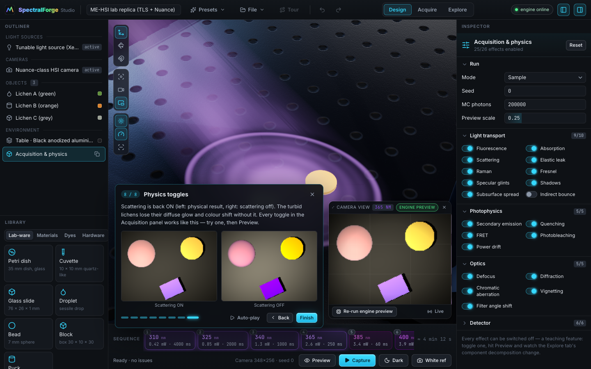

> *Indirect bounce* is listed but not implemented in the engine in this version (v1). The inspector shows it disabled with a "not yet implemented" tooltip; it cannot be switched on.

## 5. Preview, Capture, Dark, White reference

| Button | What happens |
|---|---|
| **Preview** (`Space`) | The physics engine renders **one** excitation (the chip you selected, otherwise the first enabled one) at reduced resolution (the *preview scale*, default 1/4 of the sensor) with all the physics. Takes about a second after the first run. The result appears in the Camera view as **Engine preview** (it turns "stale" when you edit the scene afterwards) and in the Explorer as a capture of mode *preview*. Use it while you design |
| **Capture** | The **whole** sequence at the full sensor resolution, in order, with bleaching accumulating from step to step. For the lab-replica preset (8 lines, 31 bands, 348 × 256) it took about 15 seconds on a laptop with warm caches; the first run after installation takes about a minute longer for one-off preparation (see the README) |
| **Dark** | A dark frame: the source is switched off (power 0). What remains is the detector: offset, dark current, hot pixels, read noise (and room light if you enabled it) |
| **White ref** | A flat-field reference: the samples are replaced by a diffuse white Spectralon plate that fills the field of view, lit by the broadband (white) part of the source. You get one frame per excitation step with the *same band set* as the sample frames, so *sample ÷ white* is the lab's white-light normalisation. No Raman, no excitation leakage, no bleaching |

The status line at the bottom reports **errors** (invalid configuration) and **warnings** as you edit; click the count to read them. Typical warnings: the excitation line lies inside the camera's band range and is not blocked by the long-pass (scattered excitation will leak into the cube); the beam misses every object; an object is outside the depth of field; a specular reflection of the source enters the camera; saturation; very low signal-to-noise. The engine also puts the warnings of a finished capture in its details.

## 6. The Explorer

Open **Explore** (`3`). On the left, the **Captures** list (newest first, with mode, size, number of excitations); under it **Compare**, **GT overlay** and **Export**. In the middle, the image; on the right, the **Analysis** panel.

* **Excitation tabs** (above the image): one tab per excitation line, coloured by wavelength. `Up`/`Down` switch lines.
* **Band scrubbing**: the slider under the image (or `Left`/`Right`) steps through the emission bands of the selected excitation; the label shows the band number and centre wavelength. **Play** (button or `Space`) animates through the bands. Note that the band list differs per excitation if the camera uses the excitation-offset start policy.
* **Colour modes** (above the image on the right): **Band** (one band in a colormap you choose, with adjustable contrast percentiles, optional *log* and *global scale* so that bands share one intensity scale), **True colour** (each band is given the colour of its wavelength and the bands are summed per pixel, an approximation of how the emission would look to the eye; the Camera view in the Design/Acquire modes uses the engine's stricter CIE 1931 rendering instead) and **False colour** (three bands mapped to RGB).
* **Pixel decomposition**: with the pointer tool selected, click a pixel (drag to move the marker). The **Analysis** panel shows, for the selected excitation:
  * the **component decomposition**: a stacked area plot of the noise-free radiance split into physical origins: each dye's fluorescence, its *re-emitted* (secondary) part, elastic scatter, specular glint, water Raman, excitation leak, the background slab, room light; the white dashed line is the engine's total. The table below gives each component's share. This is the ground truth that a real instrument can never give you;
  * the **spectra** of that pixel for all excitation lines (ADU, i.e. including noise and detector effects);
  * the **excitation-emission matrix** of the pixel;
  * the **ground truth** at that pixel: material, object, depth, incidence and view cosines, path length, thickness, shadow flag, irradiance and absorbed photons per dye, concentration per dye, bleached fraction per dye (*all* shows the complete list).
* **Ground-truth overlays**: choose a layer in **GT overlay** (for example `material`, `object`, `conc:NADH`, `bleached:EGFP`, `depth_mm`, `irradiance@365`, `shadow`). It is blended over the image with a false-colour scale; choose *none* to remove it.
* **ROI**: switch to the ROI tool, drag a rectangle; the Analysis panel shows the **mean spectrum** of the region (ADU) and its size.
* **Compare**: choose a second capture in **Compare**. The two images are shown side by side with the same band, pixel and ROI, which makes it easy to compare, say, a scattering-on and a scattering-off run, or a sample and its white reference.
* The panel at the bottom of the Analysis column lists the capture's size, number of excitations, bands, exposure and power for the selected line, the fraction of saturated samples, engine timings and the capture's warnings.

## 7. Exports and loading them in the existing pipeline

**Explore > Export** (left column) offers five formats. They download from the engine, so they are not available in offline (mock) mode.

| Format | File | Contents |
|---|---|---|
| `spectradata pkl` | `<name>_<id>.pkl` | The capture in exactly the layout of `SpectraData.to_pickle` of this repository (see below) |
| `npz` | `.npz` | `adu_<ex>`, `radiance_<ex>`, `emission_nm_<ex>`, `gt_<layer>` arrays, `excitations_nm`, `experiment_json` |
| `tiff zip` | `.tiff.zip` | One multi-page 16-bit TIFF per excitation (pages = bands, ADU), band wavelengths and exposure in the TIFF description, plus `experiment.json` |
| `ground truth zip` | `.ground_truth.zip` | One `.npy` file per ground-truth layer plus `ground_truth.json` (shape and dtype of each) |
| `experiment json` | `.json` | The exact experiment (also the content of **File > Save .sfx.json**) |

### Loading a capture in the existing pipeline

The `spectradata pkl` file loads with the repository's own reader, unchanged. The ADC offset has already been subtracted and exposure times are in **seconds**:

```python
import json
from spectral_select import SpectraData

sd = SpectraData.from_pickle("ME-HSI_lab_replica_TLS_Nuance_<id>.pkl")
print(sd.excitation_wavelengths)              # [310.0, 325.0, 340.0, 365.0, 385.0, 400.0, 415.0, 430.0]

ex = sd.get_excitation(365.0)
print(ex.cube.shape, ex.cube.dtype)           # (256, 348, 31) float32  (H, W, bands), offset removed
print(ex.emission_wavelengths[:3])            # [420.0, 430.0, 440.0]
print(ex.exposure_time, ex.laser_power)       # 0.25 s, delivered power in mW (includes drift)
print(sd.spatial_shape, sd.mask.shape)        # (256, 348) (256, 348) - mask is all True

md = sd.metadata                              # Studio's extras land in .metadata
print(md["source"], md["capture_mode"], md["seed"])        # SpectralForge Studio sample 0
experiment = json.loads(md["experiment_json"])             # the experiment that made the cube
print(md["ground_truth_layers"][:3])
```

From here everything in `spectral_select` (the `Analyzer`, the visualiser, the GUI) works as on real data. The ground-truth layers are in the separate `ground truth zip`; for example:

```python
import io, json, zipfile
import numpy as np

with zipfile.ZipFile("<name>_<id>.ground_truth.zip") as zf:
    layers = json.loads(zf.read("ground_truth.json"))               # {name: {shape, dtype}}
    material = np.load(io.BytesIO(zf.read("material.npy")))         # (H, W) index into experiment["materials"]
    conc_nadh = np.load(io.BytesIO(zf.read("conc:NADH.npy")))       # (H, W) µM
```

Layer values: `material` indexes `experiment["materials"]` (−1 = none); `object` indexes `experiment["objects"]` (−2 = background, −1 = none). Arrays have shape `(H, W)` with row 0 at the **top** of the image.

A saved `.sfx.json` can also be simulated without the browser, for batch runs:

```python
from spectraforge.studio.capture import capture
from spectraforge.studio.exports import build_export
from spectraforge.studio.schema import Experiment

exp = Experiment.model_validate_json(open("my_experiment.sfx.json").read())
result = capture(exp, scale=0.25, excitations=[365.0, 415.0])      # quarter resolution, two lines
payload, filename, _ = build_export(result, "batch1", exp.name, "spectradata_pkl")
open(filename, "wb").write(payload)
```

(Run it from the repository with `PYTHONPATH=src`, or after `pip install -e .`.)

## 8. Keyboard shortcuts

| Key | Action |
|---|---|
| `G` / `R` | Move / rotate gizmo |
| `S` | Toggle snapping (25 mm, 15°) |
| `F` | Frame the selection or the bench |
| `C` | Look through the HSI camera (`C` or `Esc` to leave) |
| `Space` | Run an engine **Preview** (in the Explorer: play / pause the band animation) |
| `Delete` / `Backspace` | Delete the selection |
| `Esc` | Leave look-through, or clear the selection |
| `Cmd/Ctrl+Z`, `Shift+Cmd/Ctrl+Z` (or `Cmd/Ctrl+Y`) | Undo, redo |
| `Cmd/Ctrl+D` | Duplicate |
| `Cmd/Ctrl+S` | Save `.sfx.json` |
| `1` / `2` / `3` | Design / Acquire / Explore |
| `[` / `]` | Hide or show the left panel / the inspector |
| `Left` / `Right`, `Up` / `Down` | Explorer: previous / next band, previous / next excitation |
| `Shift` while dragging an aim handle | Move the target vertically |

Shortcuts are ignored while you type in a field.

## 9. The guided tour

Press **Tour** in the top bar, or open the app with **`/?tour=1`** (for example `http://127.0.0.1:8765/?tour=1`). The tour is an eight-step captioned walkthrough with camera fly-throughs, built for demonstrations:

1. The bench. 2. Camera optics (focus plane, field of view, depth of field). 3. Source and beam. 4. Samples and materials. 5. Engine **Preview**. 6. A live **Capture** with progress. 7. Pixel decomposition in the Explorer. 8. Physics toggles (scattering off versus on, side by side).

`Right` / `Left` navigate, `Esc` ends the tour, the dots jump to a step, **Auto-play** advances on a timer. Variants: `/?tour=auto` starts with auto-play and `&step=N` starts at step N+1 (for example `/?tour=1&step=4`). The tour works with the real engine and in mock mode, and your experiment is restored exactly when it ends.

| | |
|---|---|
| 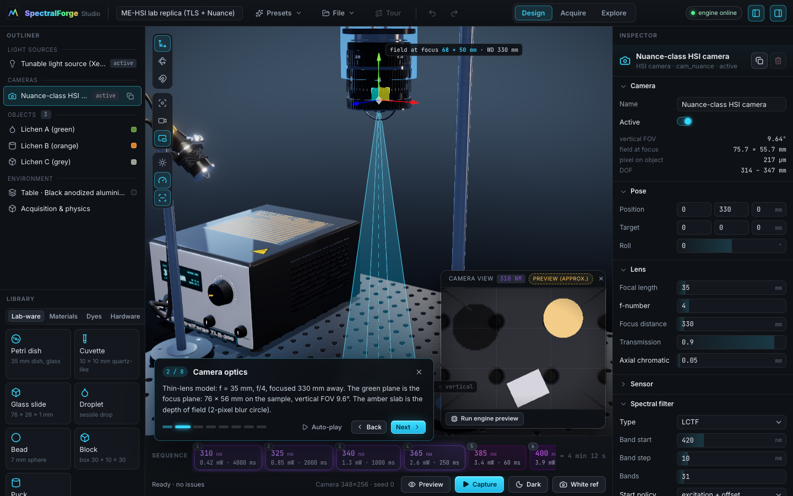 | 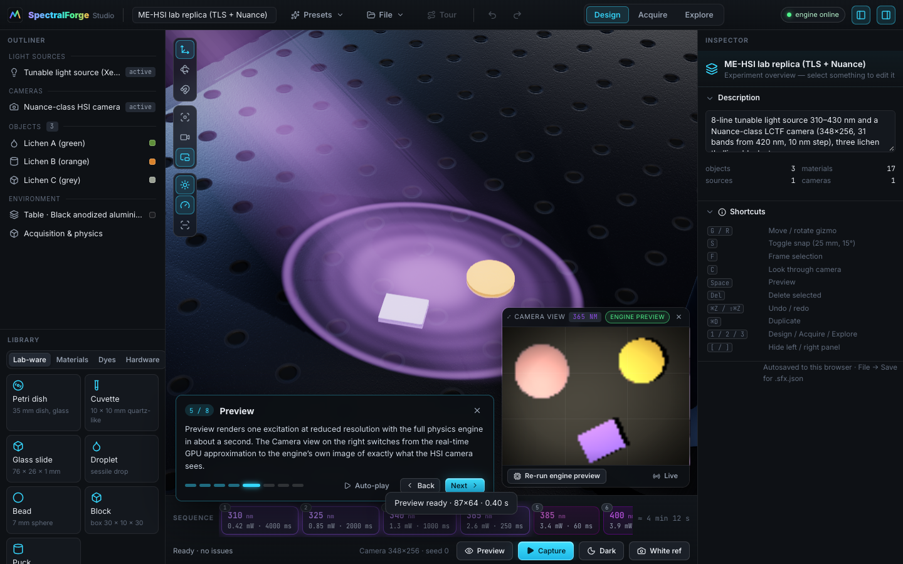 |

## 10. Offline (mock) mode

If the Python engine cannot be reached, the app does not stop: it falls back to a synthetic, in-browser engine and shows **"engine offline — mock data"** in the top bar. In this mode you can still design, preview, "capture" and explore, but the data is generated by a crude client-side model, **not by the physics simulation**; exports are unavailable. Use it for layout and demos without a laptop's engine; never for science. Click the badge to retry the connection once the engine is running.

## 11. Tips for demos and projectors

* **Warm up first.** Start the engine a minute before the talk and wait until `http://127.0.0.1:8765/api/health` reports `"state": "done"` under `warmup`; otherwise the first Preview pays the one-off preparation cost.
* **Run one Capture beforehand** so that the Explorer has data, and keep the capture list in mind: only the last 10 captures of a server session are kept.
* **Resolution.** The layout is designed for 1280 × 720 and up (the tour screenshots exist for 1280 × 720, 1366 × 768 and 1440 × 900). Hide the left panel with `[` for a larger viewport.
* **Contrast.** The interface is dark; on a bright projector set the Explorer colormap to *viridis* or *turbo* and use *global scale* when comparing bands. True colour is the most intuitive for an audience.
* **Slow GPU or software rendering?** Turn off *Render quality* (the gauge button in the viewport toolbar): it removes ambient occlusion and anti-aliasing.
* **Tour with auto-play** (`/?tour=auto`) is a self-running demo: about a minute of captions plus whatever time the engine needs for the preview and the capture in steps 5 and 6.
* **Back-up plan.** Keep a saved `.sfx.json` of the demo experiment and an exported `spectradata pkl` of a finished capture; both are a double-click away.
* **Do not edit during a capture.** The capture uses the experiment as it was when you pressed the button, but the Explorer shows it next to your edited scene; wait for it to finish.

---

## 12. Layered blocks (v1.1)

A **layered block** is a rectangular stack of layers, bottom to top, for example *substrate / fluorescent layer / cover*. Use it when what matters is how light travels **inside** a sample: a fluorophore buried under a scattering, absorbing cover (tissue under collagen, a dye layer under an intralipid film). Every layer has its own material (any material of the library, so the tool is not tied to tissue) and a **thickness profile**.

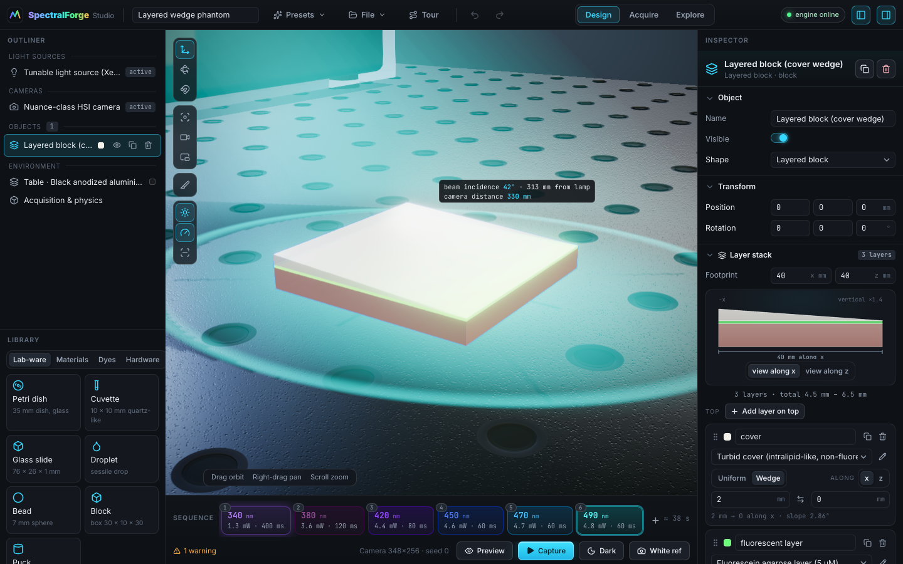

**Adding and editing.** Drag *Layered block* from the Library (or load a preset, below). Select it: the Inspector shows the **Layer stack** editor with a live cross-section drawing. For each layer you set the name, the material (or *new material* to create one), and the thickness:

* **uniform**: one thickness everywhere;
* **linear wedge**: thickness runs linearly along the block's local `x` or `z` axis from a start value (at the negative edge) to an end value (at the positive edge), for example a cover thinning from 2 mm to 0. *Flip* swaps the two ends. Because every profile is linear, every interface is an exact plane (the engine relies on that).

Layers can be added, duplicated, deleted and reordered by drag and drop (at most 8). The footprint (x by z, mm) is set above the stack. The editor warns about missing materials and zero total thickness.

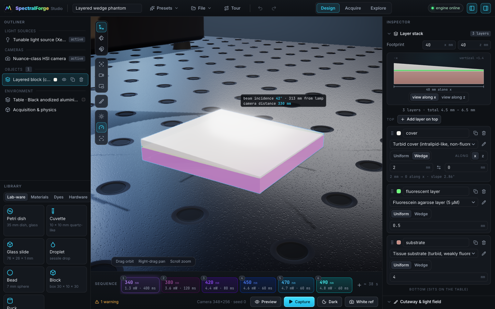

**Cutaway.** *Cutaway & light field* (Inspector, or `X`) removes half of the block with an exact planar cut, normal to `x` or `z`, at any position; the cut face is capped and shows the layers (and any wedge) in cross-section with thickness callouts. *Flip side* keeps the other half. The cutaway is a view setting, it is not saved in the experiment.

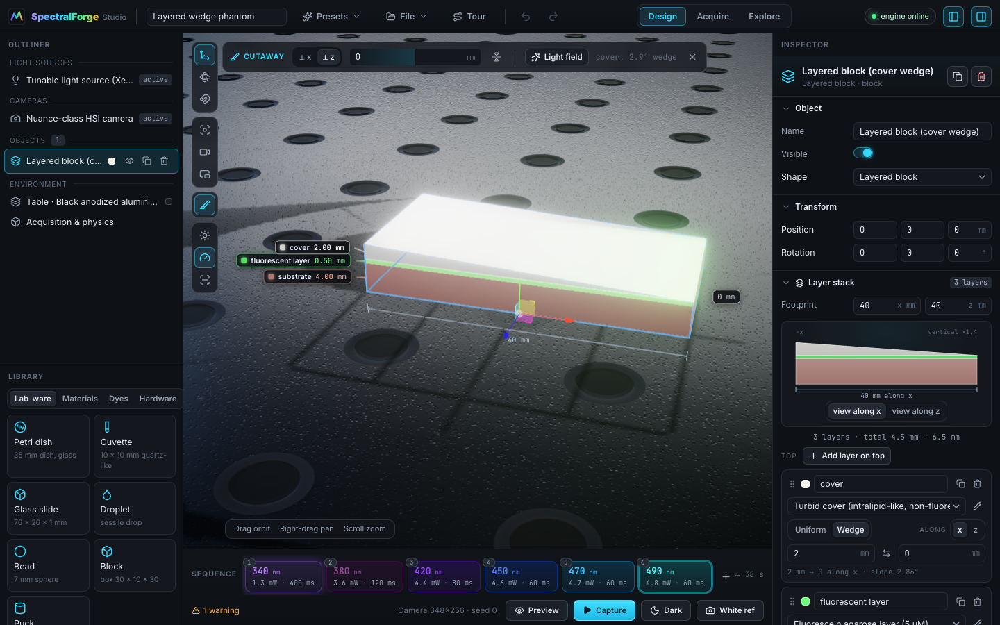

**Light field.** After a capture of a block, switching *Light field* on paints the 3D Monte Carlo result on the cut plane: **fluence** (excitation light, mW/mm²), **absorbed** power per volume, or the fluorescence **source** of one (layer, dye) channel, on a log colour scale (range in decades). You can see the cover scatter and absorb the beam and the buried layer light up. The same field is available, with sections and depth profiles, in the Explorer (section 13).

**3D Monte Carlo settings.** Select the *Acquisition* object: the *3D Monte Carlo* section sets the photon count per pass, the voxel grid (cells per layer and sublayers), the emission-node spacing and the acceptance cone. The defaults are tuned so that a preview takes a few seconds and a full capture about a minute; raise the photon count for smoother images. The cost estimate in the Acquire bar includes the blocks.

**Presets with blocks.**

| Preset | What it shows |
|---|---|
| *Layered wedge phantom* | fluorescein layer under an intralipid-like cover thinning 2 to 0 mm: the buried signal falls with cover thickness |
| *Tissue under collagen* | NADH/FAD tissue under a collagen cover (1.5 to 0.05 mm): attenuation, spectral filtering and the cover's own autofluorescence |
| *Pencil-beam penetration* | a 1 mm laser (405 / 450 / 488 nm) at 45 degrees into tissue under 0.5 mm of collagen, built to show the light plume spreading under the entry point and a fluorescence spot broadened by scattering |

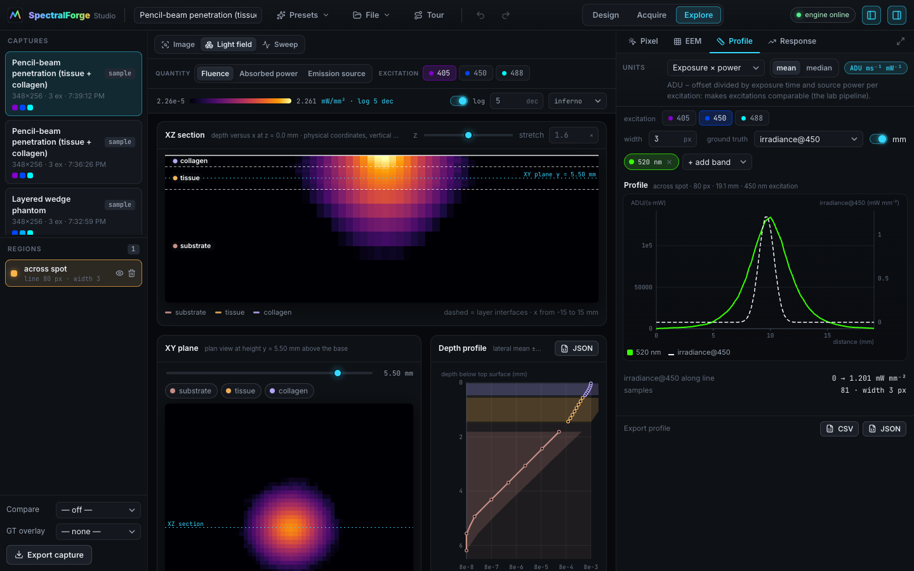

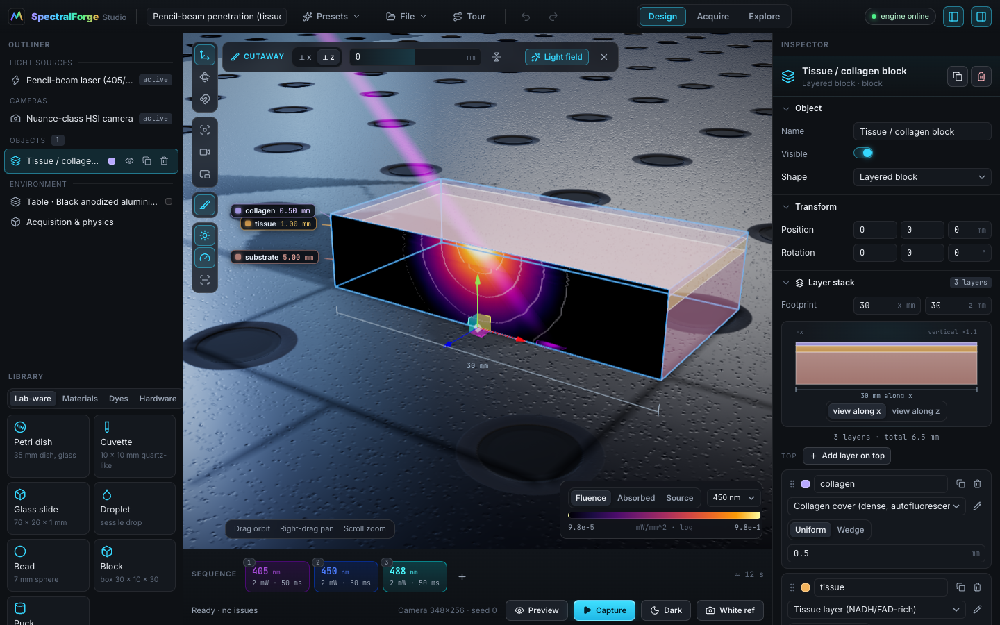

The *Pencil-beam* tip: choose the 450 nm excitation, open *Light field*, set the section at `z = 0` (the beam plane) and use a 4 to 5 decade range. With the preset's tissue scattering (reduced scattering about 1.2 to 2 per mm) the photons lose their direction within 2 to 3 mm, so the plume is a teardrop that leans only slightly along the beam, not a pronounced banana; the broadening is obvious in the line profile below (the spot is about 3.4 mm wide at half maximum for a 1 mm beam). The first emission band next to the excitation line (ex + 20 nm) is saturated by the laser's elastic light on this preset; read the bands at ex + 40 nm and beyond.

The guided tour has four extra steps (*Layered block*, *Cutaway and the wedge*, *3D capture*, *The light field*).

## 13. The analysis workspace (v1.1)

Explore mode has three workspaces (tabs above the image column): **Image**, **Light field** and **Sweep**, and a four-tab analysis panel: **Pixel**, **EEM**, **Profile**, **Response**. Every result exports to CSV (with a self-describing `#` header: units, ROI, normalisation, capture, experiment) and JSON.

**ROI tools** (above the image): `V` select, `P` point, `D` disk, `R` rectangle, `E` ellipse, `G` polygon (Enter or double-click closes, Backspace removes a vertex, Esc cancels), `L` line. Regions are named, coloured and listed on the left (rename, hide with `H`, delete with `Del`); drag a region or its handles to edit it.

**Units bar (normalisation).** Every analysis tab has one. It decides what a "value" is:

| Mode | Value | Use it for |
|---|---|---|
| Raw ADU | counts as recorded | looking at the detector |
| Radiance | calibrated radiance | physics comparisons |
| Electrons | photo-electrons | noise work |
| Dark-subtracted | ADU minus a *Dark* capture | removing offset and fixed pattern |
| Exposure x power | (ADU - offset) / (exposure x power) | comparing excitations (the lab pipeline) |
| White-normalised | (sample - dark) / (white - dark) | dividing out illumination and optics with a *White ref* capture |
| **Irradiance-normalised** | (ADU - offset) / (exposure x E_ex), E_ex = the ground-truth surface irradiance at the pixel (mW/mm²) | **signal versus structure on obliquely lit samples**: it divides out the lamp's spatial gradient, so a trend with cover thickness is not confused with the lamp falling off across the block. Pixels with E_ex = 0 or below 1e-3 of its maximum are blank (a narrow beam’s tail). |

Dark and white captures must have the same size, excitations and bands; the bar picks the newest compatible one and says why one does not fit. Hovering the mode shows the explanation.

* **EEM**: the excitation-emission matrix of the selected region (a pixel, a disk or any ROI), as a heatmap with contours, a log option and hover read-out, plus the emission spectrum per excitation and the excitation spectrum per band, with the mean or median and the standard deviation. Modes: *Single*, *Overlay*, *A - B*, *A / B* (two regions, or the same region in two captures). Optional averaged component decomposition.
* **Profile**: the bands of one excitation along a line (width in pixels), with a ground-truth trace on a second axis (for example layer thickness); the x axis is in millimetres where the geometry is known. Across a fluorescence spot it shows the spot's width directly.
* **Response**: a metric (one band, a band ratio, a band-range sum or the peak wavelength) against a ground-truth map (layer thickness, depth, origin depth...), as a binned mean with standard deviation over a faint scatter, with the correlation and first-to-last change. The headline plot is fluorescence versus cover thickness.

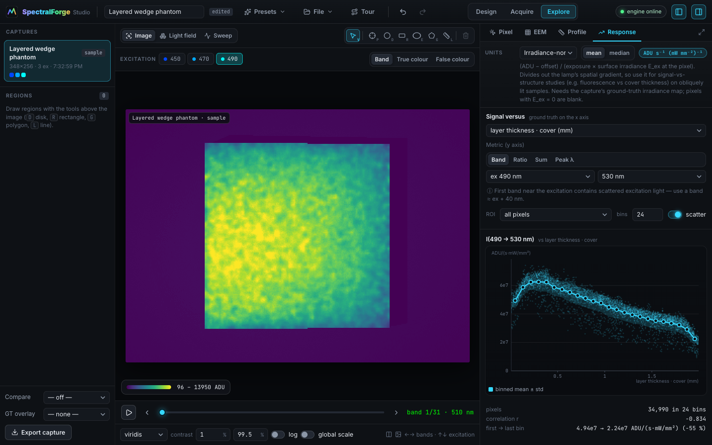

**Defaults for layered blocks.** The first camera band after the excitation line (ex + 20 nm) is dominated by scattered excitation light that leaks through the filter, and it rises with cover thickness while the fluorescence falls. When a capture contains a layered block the Response panel and the Sweep metric therefore start with: the excitation closest to the absorption peak of the buried fluorophore, the band at about ex + 40 nm (clean fluorescence) and *Irradiance-normalised* units. A small hint ("first band near the excitation contains scattered excitation light") appears under the metric whenever a near-excitation band is chosen. You can change all three; the choice is made once per capture.

* **Light field** workspace: fluence, absorbed power or a fluorescence source per layer and dye, as an **XZ section** (depth versus x at a chosen z, in physical coordinates so wedges look like wedges, layer interfaces drawn) and an **XY plan** at a chosen height, plus the lateral-average depth profile per layer. For a beam in the `x`-`y` plane, put the section at `z = 0`.
* **Sweep**: pick any numeric experiment parameter (searchable: layer thicknesses, dye concentrations, scattering, source power, camera...), a range or a list, *Preview* (one excitation, fast) or *Full*. Each point is a capture; the ROI-averaged metric is plotted as the points arrive, and clicking a point opens its capture. Typical use: cover thickness 0 to 2 mm.

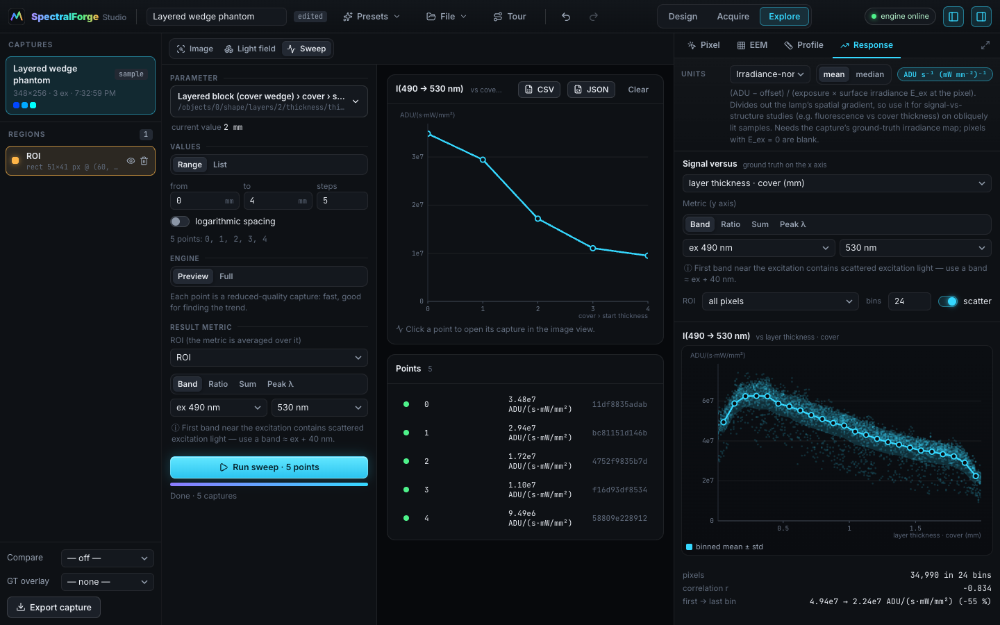

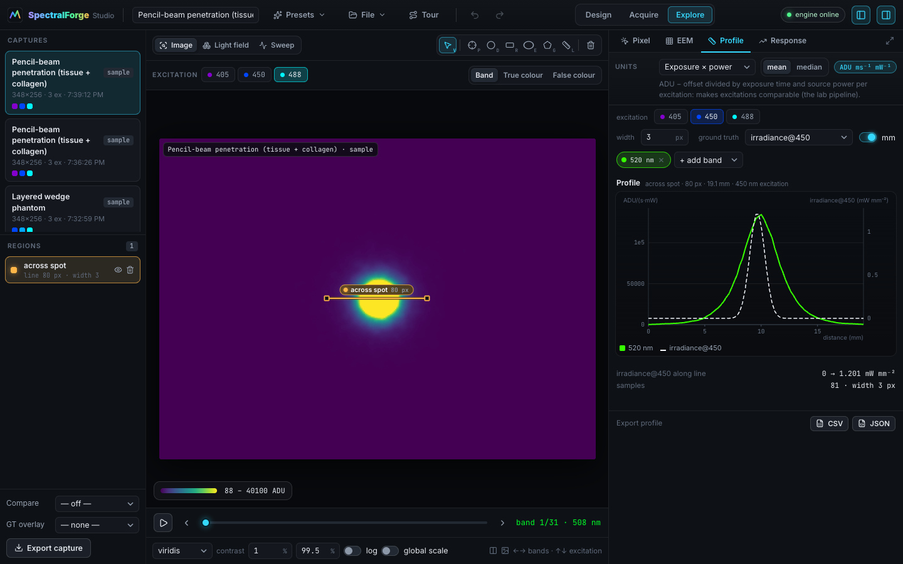

## 14. Using a capture in a notebook

Download a capture as **npz** (Explorer, *Export capture*) and analyse it offline with exactly the functions the UI uses; no server is needed.

<!-- notebook-snippet -->
```python
from spectraforge.studio import analysis as an

cap = an.load_npz_capture("my_capture.npz")            # CaptureResult incl. ground truth and 3D volumes
norm = {"mode": "irradiance_normalized"}                # (ADU - offset) / (exposure x surface irradiance)
roi = {"shape": "disk", "x": 12, "y": 8, "radius_px": 3}
eem = an.eem(cap, roi, norm)                            # mean EEM of the disk
print(eem.unit, eem.excitations_nm)
curve = an.response_curve(cap, "layer_thickness:cover",
                          {"kind": "band", "ex": 365, "band_nm": 460}, bins=8, norm=norm)
print(curve.bin_centres, curve.mean)                    # signal versus local cover thickness
```

Other functions: `an.roi_stats` (adds ground-truth statistics), `an.line_profile`, `an.normalize` (whole normalised cubes), `an.volume` (3D light-field arrays) and `an.volume_infos`. Dark and white references are passed as `dark=` and `white=` (also loaded with `load_npz_capture`). The snippet above is executed by the test suite (`tests/studio/test_analysis.py`).
